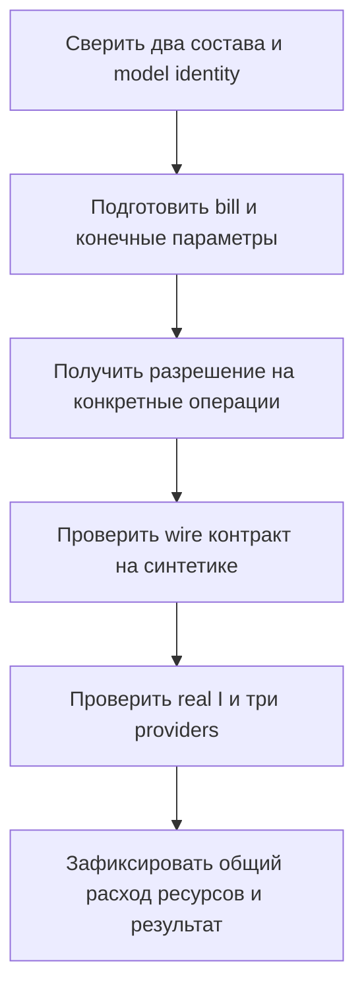

# План проверки Mac и раздельного HTTP-контура I

| Поле | Значение |
|---|---|
| Версия / дата | v0.3 / 2026-10-07 |
| Статус | PENDING_OWNER_APPROVAL для технического плана; реальный runtime NOT_RUN |
| Выбор владельца | Отдельный HTTP I в своей среде, direct POST; ручной контроль небольших фото на Mac |
| Основание | [HLD v0.5](nail-search-hld.md), [HTTP-контракт](candidate-i-http-contract.md) |
| Не входит | Объединение locks, J, VM/интернет, restricted corpus/build, прежние claims, автоматическое обновление моделей |

## Простыми словами

Проверяем две среды и связь между ними: I выделяет области в своём процессе, основная система кодирует crops и ищет товары. Успешная передача PNG не доказывает, что модели работают; успешные модели не доказывают качество top-10.

## 1. Два окружения и предел доказательства

Существующие backend и I среды сохраняются как контрольные. I-service HTTP dependencies получают отдельный proposed bill/lock; поиск сохраняет свой lock. Полный фактический I inventory до новой сборки UNKNOWN. Все revisions и device проверяются заново. Замена процесса не разрешает молча менять модель, CPU/MPS или precision.

Объединение среды было историческим направлением v0.1/v0.2, заменено выбранным HTTP. Его COMPATIBLE сейчас не требуется. Новый результат относится к совместимости раздельного HTTP-контура, не доказывает merged-runtime.

## 2. Доступные исходные сведения

| Компонент | Поиск: закреплено в репозитории | Выделение: исторические кандидаты | Что установить до сборки |
|---|---|---|---|
| Python | Проект `>=3.12,<3.13` | Исторический контур CPython 3.12 arm64 | Точные интерпретаторы, архитектура и поддержка wheels |
| PyTorch | `2.13.0` | `2.4.1` | Версия фактически принятого I-lock; допустимое пересечение constraints |
| torchvision | `0.28.0` | `0.19.1` | Совместимая пара с PyTorch |
| Transformers | `5.16.1` | `4.44.2` | Совместимость LangSAM/Grounding DINO и DINOv2/SigLIP2 |
| NumPy | `2.5.3` | `2.2.5` | ABI и ограничения всех зависимостей |
| LangSAM / SAM 2 | Не входят в gate3 lock | Exact source revisions перечислены в ведомости | Фактические install metadata, lock и ограничения выбранных revisions |
| OpenCLIP / timm / tokenizers | Есть в gate3 lock | Полный принятый I-lock здесь не инвентаризирован | Проверить транзитивные ограничения, не только прямые версии |

Значения поиска сверены read-only по [gate3 lock](../../../../../.codex/worktrees/1eaf/Ai/scripts/requirements-gate3-macos-arm64.lock) и [pyproject.toml](../../../../../.codex/worktrees/1eaf/Ai/pyproject.toml). Столбец выделения — кандидаты из [dependency ledger §3](../../../../../.codex/worktrees/1eaf/Ai/docs/nail-localization-dependency-ledger.md), не доказательство состава текущего рабочего окружения. [Readiness](../../../../../.codex/worktrees/1eaf/Ai/docs/nail-localization-worker-readiness.md) подтверждает исторический факт отдельного I-runtime, не текущую совместимость.

Различие версий не доказывает конфликт. Совпадение прямых версий не доказывает работоспособность. Полные транзитивные requirements, VCS revisions и платформенные build options нужно сопоставить отдельно. Старую ведомость или J-addendum нельзя принять за объединённый lock.

## 3. Подготовка bill до запусков

Read-only собрать interpreter/platform, оба exact locks и fingerprints, I code/models/config identity, HTTP/PNG dependencies, existing offline snapshots. Новые runtime inputs и версии предъявляются владельцу; старые working среды не переписываются. Сеть, установка и bootstrap/model load требуют отдельного операционного разрешения. Исполнимого pip install без exact bill этот план не содержит.

До model-backed старта определить положительные конечные connect/write/read/overall deadlines, max decoded pixels, region/solver state budgets, max response bytes и memory ceiling двух процессов. Wire transport caps приняты в HTTP-контракте v0.1 2026-10-07; остальные численные runtime/NFR значения этим утверждением не установлены. Значения остальных параметров UNKNOWN; fake tests используют отдельные явные тестовые values. Владелец на Mac вручную ограничивает фото уровнем ранее испытанных, точный исторический предел пока не извлечён и не придуман. Новая полноценная stress/load программа не входит в scope.

## 4. Проверки после разрешения

| Проверка | Подтверждает | Не подтверждает |
|---|---|---|
| Оба locks/imports/dependency check | Воспроизводимый состав каждой среды | Работу model paths |
| HTTP fake/synthetic RGB PNG | Без потерь byte round-trip, metadata/identity/error mapping, маски | Реальное выделение I |
| Offline load I и providers | Loader/config/weights в своих средах | Ногти или качество выдачи |
| Real I на generated RGB | Detector path; NO_NAILS допустим | Непустой segmenter path |
| Synthetic SAM с заданной областью | Segmenter path и mask contract | Способность detector найти ноготь |
| Три providers на одной synthetic crop | Finite L2 512/768/768 vectors | Семантическую идентичность товаров |
| HTTP real I и main providers последовательно | Межпроцессную стыковку, actual fingerprints и выбранный lifecycle | Производственную нагрузку или top-10 качество |
| Busy/cancel/timeout с fake длительным заданием | Admission/device lease удерживаются до конца; POST не повторяется; late response не публикуется | Принудительное прерывание native inference |
| Shared device/coordinator lease | Нет одновременных model операций, HTTP не держит родительскую device lease; app/batch исключены | Достаточную память при resident моделях |
| Cleanup/restart и воспроизводимость | Свой private spool очищен, catalog/evidence сохранены, profiles воспроизводимы | VM/Linux-переносимость |

Синтетические входы создаются отдельно; старые evaluation/calibration и corpus не открываются. Выбранный MPS/CPU проверяется без silent fallback. Cold load, повторные вызовы, PNG/Base64 overhead, peak memory и residency измеряются только в заранее ограниченной разрешённой серии; число входов/длительность/лимиты фиксируются в bill до запуска. Численные results пока UNKNOWN.

## 5. Критерии результата

- COMPATIBLE_HTTP_PROFILE: два exact состава и фактические identities закреплены; реальные detector/segmenter/три providers и HTTP mapping проверены; общий lifecycle укладывается в принятые пределы; воспроизводимость подтверждена.
- REWORK: нет обязательной ветки, нарушен contract/resource limit или нужна смена принятой версии.
- INCOMPATIBLE_FOR_SELECTED_PROFILE: воспроизводимое несовпадение выбранных составов/протокола/ресурсов, не вывод из одного failed install.
- BLOCKED: отсутствует необходимый lock/snapshot/конечный profile parameter или операционное разрешение; это не PASS imports.

Технический результат не принимает продукт и не разрешает build данных. Ограничение размера фото вручную не объявляется измеренным memory ceiling. Отсутствие общего lock больше не блокирует HTTP fake ядро.

## 6. Evidence и дальнейшая работа

Безопасный отчёт содержит только code/lock/model/profile fingerprints, contract version, actual platform/device, таблицу выполненных проб и агрегаты. Фото/маски/Base64, private paths, secrets и сырые inventories не переносятся в Git/чат. После принятого результата закрепляется HTTP runtime_profile; real data/build и ручная оценка качества остаются отдельными разрешёнными действиями.

## 7. История и проверка

v0.1/v0.2 от 2026-10-04/06 были планом общей среды; исторические reviews относятся к ним. v0.3 синхронизирован с выбранным HTTP 2026-10-07. Новое review в [отчёте](nail-search-documents-review.md). Рендер и runtime не выполнялись.
