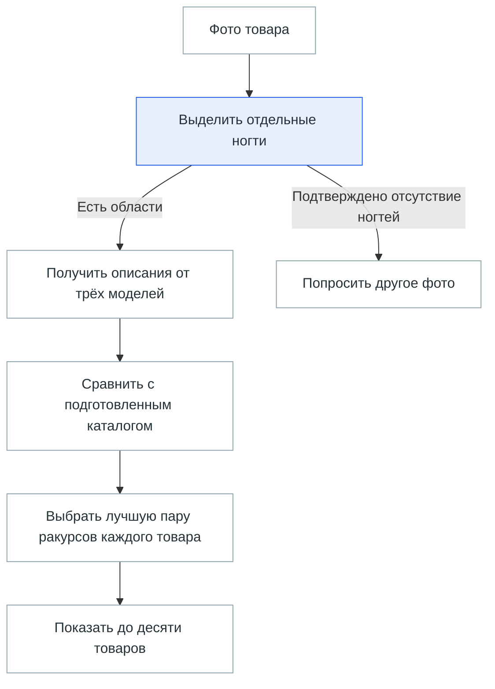
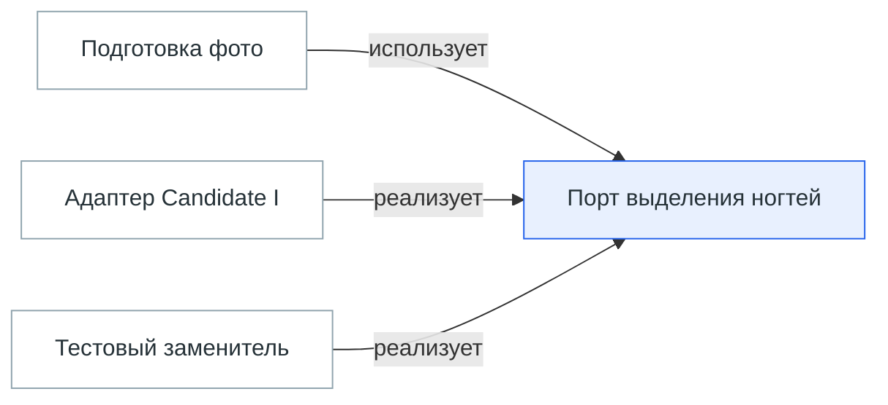
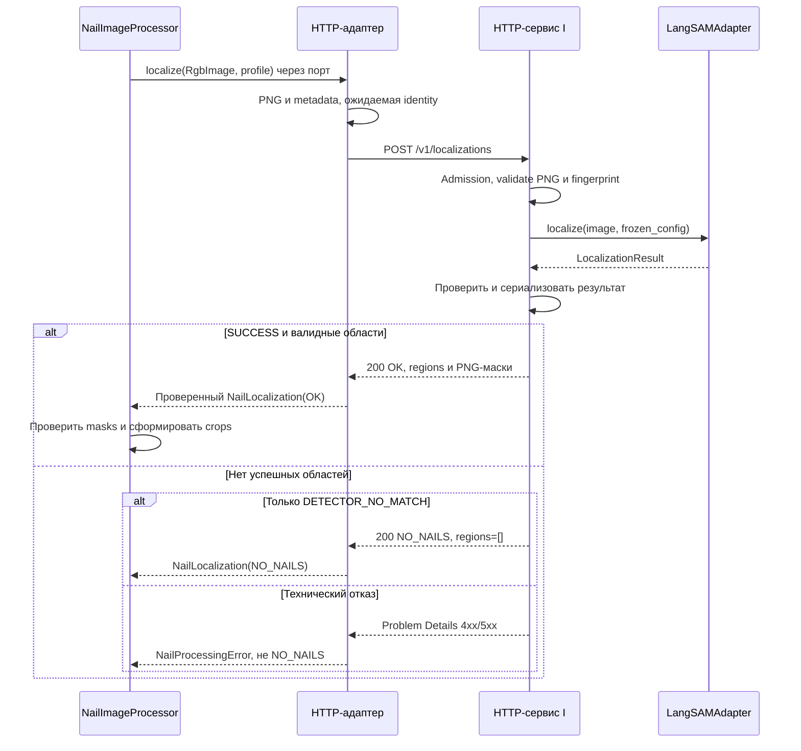

# HLD — подключение Модуля выделения ногтей к поиску

> Навигация: [карта проекта](../project-map.md). Паспорт и датированные статусы ниже относятся
> к своим версиям/контрактам; текущее исполнение и ограничения указаны в карте.

| Поле | Значение |
|---|---|
| Версия / дата | v0.5 / 2026-10-07 |
| Статус | Остальные детали HLD v0.5 — PENDING_OWNER_APPROVAL; HTTP v0.1 и G2/G3 APPROVED_BY_OWNER; fake/synthetic US1–US3 проверены; real ML/corpus/working DB NOT_RUN |
| Владелец и утверждающий | Владелец проекта |
| Основание | Запрос подготовить HLD и [пакет системного анализа](../analysis/nail-search-v1/README.md) |
| Следующий gate | Проект LLD уже подготовлен → утверждение выбранных контрактов HLD/LLD владельцем → немодельная реализация; ML, миграция действующей БД и данные отдельно |
| Область | Первая итерация поиска накладных ногтей; код, окружения и данные не меняются |

## Простыми словами

HLD — общая схема устройства будущего поиска с гексагональной границей. Документ объясняет, какие части нужны, за что они отвечают и как передают результат друг другу. Детали полей, формул и таблиц раскрывает [LLD](nail-search-lld.md).

Пользователь загружает фото товара. Модуль выделяет отдельные ногти, а три модели превращают каждую обрезку в числовое описание — embedding. Поиск сравнивает эти описания с заранее подготовленным каталогом и показывает до десяти товаров. Числовая оценка означает сходство по предлагаемому алгоритму, а не вероятность того, что товар тот же.

Упрощённый путь пользовательского запроса; каталог готовится заранее по отдельному разрешению:

**Пример.** Пользователь добавил второй ракурс того же товара. Поиск заново сравнивает накопленные фото и выбирает лучшую пару «фото запроса — фото товара в каталоге». Простое добавление фото ещё не означает, что пересчёт выполнен. Если модель сломалась, это техническая ошибка, а не ветка «ногтей нет».

**Простыми словами о портах и адаптерах.** Ядро определяет, какие данные ему нужны: изображение, найденные области, векторы и подготовленный каталог. Порт — этот договор. Адаптер — конкретная реализация договора через Candidate I, модель или PostgreSQL. Web и CLI вызывают одни и те же сценарии ядра. В тесте порт выделения можно подключить к заменителю, возвращающему две заданные маски.

Схема зависимостей для выделения; стрелки показывают использование или реализацию контракта, а не порядок вызовов:

Документ нужен при обсуждении границ компонентов и общих решений. Обвязка агента определяет порядок работы разработчика; она не добавляет компонент в продуктовую схему. Последующая разработка следует [утверждённому методу](../development-method.md) и [инструкциям проекта](../../AGENTS.md). Пояснение и схема пересказывают проект; они не подтверждают работоспособность поиска.

## 1. План-контракт и границы

План-контракт v0.5: сохранить продуктовые правила; актуальная задача v0.5 — отдельный HTTP I, новый API-контракт/OpenAPI и синхронизация схем → определить ядро, входные сценарии и выходные порты → перевести Candidate I и остальные внешние зависимости за адаптеры → синхронизировать LLD, API/OpenAPI и четыре исходника схем → self-check → один независимый read-only reviewer → исправить замечания → предъявить готовый результат владельцу. Выход — проект архитектуры, без кода, установки, inference, миграций, индексации или активации. Указание владельца выбрать подход не утверждает все новые детальные контракты автоматически.

HLD разрабатывается как проект на основании записанных выборов пользователя. Сам пакет анализа пока ожидает утверждения: этот документ не утверждает его молча. Актуальный выбор владельца: отдельный HTTP I и direct POST на Mac; прежний общий процесс заменён этим решением. VM/интернет и другие backlog-сценарии отложены. Это не утверждение полной HLD или всех алгоритмических предложений. Описанные правила crop, участия областей, среднего missing0, лучшего ракурса и различения исходов приняты владельцем 2026-10-07; конкретная cosine шкала, numeric/precision, schema и новые HTTP детали остаются PROPOSED. Принятые правила первой итерации находятся в [ART-06](../analysis/nail-search-v1/06-functions.md), открытые решения — в [ART-10](../analysis/nail-search-v1/10-open-items.md).

Не входят Фильтр масок (`Candidate J`), оценка пригодности областей, поворот, дорисовка, CQRS, новая очередь, новые публичные API продукта, новая установка зависимостей или переиндексация действующего корпуса.

## 2. Текущая архитектура и доказательства

Исходный код проверен в чистой ветке `codex/gate-4-manual-testing`, HEAD `ba495046c80d25190a1745cb9f63384d00a42dd4`. HLD сохранён в основном checkout `codex/task-quality-journal`, HEAD `813dd11`, с существующими незакоммиченными процессными документами. Source-level проверка не подтверждает текущий запущенный сервис.

| Компонент | Подтверждённое устройство | Источник |
|---|---|---|
| Сборка приложения | `build_application` связывает web, storage, search и evaluation | [main.py](../../../../../.codex/worktrees/1eaf/Ai/src/product_search/main.py) |
| Поиск | `FusedSearchService.execute/execute_many` кодирует целые фото; выдача до 10 товаров | [fused_service.py](../../../../../.codex/worktrees/1eaf/Ai/src/product_search/search/fused_service.py) |
| Объединение | RRF; в многокадровом режиме лучшие ранги каждой модели могут прийти с разных фото | [rrf.py](../../../../../.codex/worktrees/1eaf/Ai/src/product_search/search/rrf.py) |
| Индексация | `index_active_corpus` читает одно `image_path` записи | [embedding_index.py](../../../../../.codex/worktrees/1eaf/Ai/src/product_search/search/embedding_index.py) |
| Хранилище embeddings | Уникальность `(corpus_version_id, product_record_id, model_key)`; несколько ногтей не помещаются в текущую семантику | [migration 0005](../../../../../.codex/worktrees/1eaf/Ai/migrations/versions/0005_gate3_search.py) |
| Точный поиск | SQL cosine по `product_embeddings`, shortlist 50 на модель | [exact_search.py](../../../../../.codex/worktrees/1eaf/Ai/src/product_search/search/exact_search.py) |
| Модуль выделения ногтей | `LangSAMAdapter.localize` и lazy local-only клиент; Grounding DINO и SAM 2.1; экспериментальный контракт `LocalizationResult` | [adapter](../../../../../.codex/worktrees/1eaf/Ai/experiments/nail_localization/langsam_adapter.py), [contracts](../../../../../.codex/worktrees/1eaf/Ai/experiments/nail_localization/contracts.py) |
| Runtime-разделение | I сохранён в прежнем окружении, J вынесен в отдельное; совместимость I с основным приложением не установлена | [worker readiness](../../../../../.codex/worktrees/1eaf/Ai/docs/nail-localization-worker-readiness.md) |

Новый поиск нельзя получить одним вызовом выделения перед старым `search_model`: меняются единица индекса, сопоставление и агрегация. Модуль выделения уже существует, но прямое подключение к поиску в общем окружении ещё не реализовано. Существующий J worker не используется в этом варианте.

## 3. Предлагаемая архитектура

**Оставить web-приложение, PostgreSQL/pgvector, файловое хранилище и существующие модели.** Изменить направление зависимостей: ядро поискового режима определяет собственные plain-data контракты и порты, а внешние адаптеры реализуют их. Гексагональная архитектура здесь — граница исходного кода и тестирования; способ исполнения I меняется на отдельный локальный HTTP-процесс.

[Компоненты — Structurizr DSL](diagrams/nail-search-components.dsl) содержат три представления: входные сценарии, ML-порты и хранилища. Стрелки `Использует контракт` / `Реализует контракт` показывают зависимости кода. [Запрос — PlantUML](diagrams/nail-search-query.puml) и [каталог — PlantUML](diagrams/nail-search-catalog.puml) показывают последовательность вызовов. Это проект TO-BE; визуальный рендер не проверен.

| Часть | Ответственность / принадлежность |
|---|---|
| Входные адаптеры Web и CLI | Валидируют внешний формат/доступ и вызывают сценарий; не рассчитывают сходство и не решают readiness |
| Ядро: `NailSearchService`, `NailCatalogBuildService`, `NailImageProcessor` | Поиск, подготовка каталога, единые правила фото, typed outcomes и прикладные инварианты |
| Чистое ядро: `match_nail_sets` | Сопоставление, формула, стабильные ties; без SDK, БД, файлов и framework |
| Выходные порты ядра | `NailLocalizationPort`, `NailEmbeddingPort`, `NailImageStorePort`, `NailCatalogPort`, `NailEvaluationPort`; контракты по потребности приложения |
| Внешние адаптеры | Candidate I через `HttpNailLocalizationAdapter` и отдельный HTTP-сервис, существующие providers через `NailEmbeddingAdapter`, файловое хранилище и PostgreSQL |
| Composition root / runtime runner | Сборка конкретных адаптеров, внешняя конфигурация, проверка фактической runtime identity, executor, ML lock, leases и cleanup |

Ядро не импортирует `experiments.nail_localization`, Pillow, NumPy, Torch, Transformers, FastAPI, SQLAlchemy, psycopg или `core.settings`; не читает env и файлы. Наружу передаются только immutable plain data. SQL-схема и модельные типы остаются за адаптерами. Дублировать ML-алгоритмы и providers не требуется: адаптеры переводят существующие интерфейсы в порты приложения.

Входные сценарии — конкретные методы сервисов поиска, build и финализации; дополнительная копия интерфейса для каждого use case не нужна. `main.py` внедряет реализации выходных портов через конструкторы. Импорты направлены от внешних деталей к контрактам ядра, хотя runtime-вызов идёт из ядра через порт к адаптеру. Код сборки может импортировать обе стороны; ядро не импортирует сборку.

Порты вводятся только для существующих внешних зависимостей. Для matcher, сортировки и арифметики отдельные адаптеры не создаются. J, дополнительные публичные/сетевые API помимо внутреннего I, worker, CQRS, DI-framework и перенос legacy режима на новую структуру не входят в этот проект.

### Отдельный HTTP-сервис Candidate I — выбранный вариант

Владелец 2026-10-07 выбрал отдельное окружение и HTTP-сервис I, затем подтвердил прямую передачу изображения в POST. Основная система сохраняет своё окружение и embedding providers. I-service имеет собственные code/lock/models/runtime identity. VM/интернет не входят в текущую площадку.

`NailImageProcessor` вызывает application-owned `NailLocalizationPort`; concrete `HttpNailLocalizationAdapter` кодирует нормализованный RgbImage в PNG, выполняет POST и преобразует JSON/PNG-маски в DTO ядра. Серверный adapter внутри I-service вызывает существующий `LangSAMAdapter.localize` и normalize_result. Основной backend не импортирует экспериментальный I или LangSAM; порт остаётся plain-data. [Точный контракт и статусы](candidate-i-http-contract.md), [OpenAPI](candidate-i-http.openapi.json).

Владелец утвердил HTTP-контракт v0.1 2026-10-07: синхронный вызов на одно фото, без очереди/retry, multipart RGB PNG и JSON/PNG-маски. Ранее это был проект; теперь его fields/formats/lifecycle приняты в границе контракта. Остальной архитектурный пакет и численные runtime parameters не утверждены этим ответом. I-service не знает каталог/SQL/ранжирование и не получает URL/путь к фото. Его ответ не является решением SAME_PRODUCT/NEW.

Один процесс I с одной instance модели; основной процесс последовательно использует три providers. App query lock и service admission lock различны. Межпроцессная device lease удерживается исполнителем реальной model операции, не backend во время ожидания HTTP; coordinator lease запрещает одновременный app/batch. Расход памяти обеих сред, модельная residency и deadlines проверяются по [плану Mac](mac-common-environment-plan.md), значения пока UNKNOWN. Автоматического перехода на CPU нет.

HTTP timeout заканчивает неуспешный новый run, но не обещает остановки I. Service/device lease остаются до actual completion или выхода процесса I. Зависание I может требовать его явного перезапуска; локальный процессный сбой отделён от backend, но общий отказ памяти Mac может затронуть обе части. Старый результат сохраняется, stale finalize запрещён.

| Вариант | Статус | Условие |
|---|---|---|
| Отдельный HTTP I и direct POST | Выбран владельцем | Готовый wire/API проект и раздельный runtime bill требуют принятия и технической проверки |
| Общее окружение и прямой вызов | Прежний выбор, заменён текущим | Не устанавливать объединённый lock по историческому плану |
| VM/интернет, J и backlog | DEFERRED | Отдельная будущая задача, не новая инфраструктура сейчас |

## 4. Контракты на уровне HLD

`NailImageProcessor.process(photo_input, processing_profile)` возвращает фото с упорядоченными областями и производными crops либо типизированный исход. Контракт plain data, не ORM, FastAPI request или объект LangSAM. Каталог и запрос используют одинаковый fingerprint подготовки.

Внешний адаптер переводит существующий `LocalizationResult`, который содержит `SUCCESS`, `LOCALIZATION_FAILED`, `TECHNICAL_ERROR`. На границе приложения предлагается различать:

- `OK`: непустые валидные области;
- `NO_NAILS`: только `LOCALIZATION_FAILED / DETECTOR_NO_MATCH`;
- `PROCESSING_ERROR`: `SEGMENTER_EMPTY`, `TECHNICAL_ERROR`, неверные masks и resource error; политика зависания отдельно.

`SEGMENTER_EMPTY` не превращается в «ногти не найдены»: detector мог увидеть области, а segmenter не дал масок. Empty/invalid mask — нарушение технического контракта, не оценка пригодности ногтя.

`NailSearchService.execute_many(SearchRequest)` возвращает кандидатов, оценки, использованную пару фото, пропущенные фото и версию представления. Не возвращает «вероятность того же товара» и не ставит итог `SAME_PRODUCT` автоматически.

Устаревшее поле `rrf_score` не использовать для нового среднего сходства. Общий DTO может иметь `score_kind`, `score`, `representation_id`; точные поля и совместимость с v3 snapshots требуют LLD.

Ядро владеет правилами оценки, readiness и обработки исходов; адаптеры обеспечивают техническую выполнимость. Например, build-сервис разрешает публикацию только при наличии OK-фото, а PostgreSQL-адаптер повторно проверяет ограничения и атомарно меняет pointer. Финализация вызывает `NailEvaluationPort` одной операцией для всей записи evidence; отдельные commits таблиц не скрываются за несколькими портами.

### Выделение через адаптер — sequence

Один вызов после нормализации входа и проверки runtime. Порт — контракт ядра; HTTP-адаптер реализует его. [PlantUML](diagrams/nail-search-localization.puml).

Transport timeout тоже становится typed error; service может ещё вычислять I. После OK сценарий отдельно кодирует crops. Каталог и запрос используют одну подготовку, а сведения о runtime закрепляются в identity. Маски не записываются сервисом в БД или рядом с оригинальным фото.

## 5. Единая подготовка изображения — предложение

Для первой итерации: существующий detection определяет crop вокруг mask; вне mask единый фиксированный белый RGB-фон; дополнительный padding 0%; ориентацию не менять; далее существующий processor каждой embedding-модели. Точные границы bbox округления, EXIF orientation, цвета, resize и fingerprint закрепить в LLD одинаково для обеих сторон.

Все корректные detection участвуют, даже боковые, частичные, с кожей или ошибочно выделенные объекты. Confidence не применяется как новый поисковый фильтр. Не изменять утверждённые параметры I для повышения качества без отдельного решения. Пропуск технически некорректных detection не разрешать молча: фото получает явную ошибку.

Владелец 2026-10-07 согласился с предложенным правилом отдельной обрезки и белого фона, участия всех корректных областей, сопоставления без повторов, среднего с missing0 и лучшей пары ракурсов без бонуса. Это принятие описанного поведения, не всех полей, numeric/runtime limits или миграций LLD. Исходные фото сохраняются, производные отдельны.

## 6. Подготовка каталога и модель хранения

Предлагаемый CLI build обрабатывает все доступные локальные фото утверждённого корпуса. Сначала безопасный inventory устанавливает число ракурсов и их связь с товарами. Автоматическое скачивание недоступных внешних фото не входит в build.

Каждый фото-результат содержит принадлежность товару, checksum входа, исход обработки и fingerprint I/crop policy. Успешные области кодируются тремя существующими providers. Частично полученный набор embeddings не считается готовым.

| Логическая сущность / предлагаемая таблица | Связи и инварианты |
|---|---|
| `search_representations` | Версия корпуса + профили I/crop + набор revisions моделей; `BUILDING / READY / FAILED`; отдельный active pointer для поискового режима |
| `catalog_photos` | representation → товар → локальное фото; checksum и исход; доступные фото инвентаризируются, не предполагаются |
| `nail_regions` | representation/photo → ordinal области, bbox, mask/crop locator и checksum |
| `nail_embeddings` | representation/region/model → vector; уникальность этой тройки, правильная размерность |

Точные таблицы, FK, storage types и миграции — LLD. Новые записи не заменяют `product_embeddings` и не меняют активный корпус. Общие `model_artifacts` не перезаписываются иной revision: representation хранит собственную модельную identity или immutable reference.

Предложение по readiness: есть хотя бы одно OK фото; все фото получают terminal outcome, нет технических ошибок, все `OK` области имеют полный набор трёх embeddings. Товары без единого `OK` фото входят в coverage report и недоступны этому режиму. Это исключение явно принимает владелец перед активацией; нельзя обещать полный охват корпуса.

Промежуточный build не читается поиском. Публикация готовой версии — атомарное изменение active pointer после review и отдельного разрешения владельца. Прерванный build продолжает только свои незавершённые записи при совпадении fingerprints; retry не открывает старые evaluation/calibration claims.

## 7. Поиск и оценка — реализуемое предложение

### 7.1 Точный обход

Для небольшого текущего корпуса предлагается точное сравнение со всеми подготовленными каталожными фото, без предварительного shortlist по отдельным ногтям. Иначе сильное одиночное совпадение может отсечь товар с лучшим совокупным соответствием. Существующий SQL `LIMIT 50` не переносится на этот этап автоматически.

Repository отдаёт векторы группами каталожных фото/товаров для закреплённой representation; координатор последовательно обрабатывает группы. Embeddings фото запроса вычисляются один раз на модель за запрос, а не для каждого каталожного фото. Полный restricted массив не выводится в логи. Размер batching, повторное использование подготовленных фото сессии и memory ceiling — LLD.

### 7.2 Сопоставление одной пары фото

Предложение: оптимальное взаимно-однозначное сопоставление по матрице сходств, а не жадный выбор первого максимума. Для каждой пары ногтей и каждой модели cosine ограничивается численно интервалом [-1,1], затем переводится в [0,1]: `s=(cosine+1)/2`.

Для каждой пары ногтей берётся среднее трёх модельных `s`. Полученная единая матрица задаёт одно сопоставление, общее для всех моделей. Выбирается набор пар с максимальной суммой, где каждая область запроса/каталога участвует максимум один раз. Каждая область запроса без пары получает принятый вклад 0. Итог пары фото — сумма вкладов, делённая на число областей запроса. Лишние каталожные области в знаменатель не входят.

Пример на готовой матрице: три ногтя запроса, два каталога; оптимальные неповторяющиеся пары имеют сходство 0.9 и 0.6, третьей пары нет → `(0.9+0.6+0)/3=0.5`. Копия второго ногтя каталога не создаётся. Числа — иллюстрация, не результаты inference.

`cosine=0` после преобразования даёт 0.5, а отсутствующая пара 0. Это выбранная проектная шкала штрафа, не эмпирический порог. Сходство разных моделей даже после линейного преобразования не калибровано одинаково: среднее — простая исходная гипотеза. На реальных данных одна модель может доминировать. Это явный предмет проверки, а не доказательство равной надёжности моделей.

### 7.3 Ракурсы и товары

Для товара берётся максимум оценок по всем парам «фото запроса — фото товара». Бонус подтверждения другими фото не добавляется. Это принятый владельцем 2026-10-07 выбор лучшей пары и отсутствия бонуса; остальные технические поля не утверждены автоматически.

Ограничение: фото с одним удачно совпавшим ногтем может получить оценку выше фото с пятью менее сильными совпадениями. Первая итерация не вводит бонус за число ногтей и фильтр пригодности; риск проверить отдельно, не обещать равную достоверность этих случаев.

При равенстве: стабильный порядок по внутреннему ID товара; внутри товара стабильный ordinal фото запроса, затем каталога. Повтор идентичного фото не повышает оценку. Все товары с успешно подготовленным представлением ранжируются, затем выбирается до 10 уникальных записей. Минимальный порог выдачи не вводится; пустой каталог/нет кандидатов не означает `NEW` автоматически.

### 7.4 Что происходит с RRF

В прежнем режиме поиска целых фото RRF сохраняется. Для nail-search-v1 владелец принял описанное объединение оценок ногтей; конкретные numeric детали шкалы в LLD остаются проектом. Нельзя подать ногтевые кандидаты в старый `fuse_multiphoto_rankings` и получить согласованное соответствие одной пары ракурсов: он выбирает лучшие ранги моделей независимо.

Альтернатива — RRF по ранжированиям полных пар фото с последующим максимумом по товару. Она лучше сохраняет независимость шкал моделей, но усложняет объяснение оценки и зависит от набора сравниваемых пар. Среднее выбрано владельцем 2026-10-07; RRF здесь — исторически рассмотренная альтернатива, не открытый выбор текущей итерации. Точные numeric детали среднего остаются проектом. Модели и их revisions сохраняются; новая модель не предлагается.

## 8. Ошибки и пользовательский сценарий

| Ситуация | Предлагаемое поведение | Статус |
|---|---|---|
| На части фото `NO_NAILS` | Пропустить с пояснением, искать по остальным | Выбрано в диалоге |
| На всех фото `NO_NAILS` | Попросить другое фото, без поиска целого изображения | Выбрано |
| Ошибка выделения или embeddings | Не публиковать частичный новый рейтинг; показать технический отказ | `PROPOSED` |
| Неудачное добавление ракурса | Сохранить ранее успешную выдачу и пояснить, что новый пересчёт не завершён; старое состояние не выдавать за обновлённое | `PROPOSED`, совместимость с v3 проверить |
| Representation не готова / полностью пустая / identity не совпадает | Не выполнять этот режим; диагностический отказ без тихого fallback | `PROPOSED` |
| Ошибка batch | Build остаётся непубликуемым; отчёт и проверка причины | `PROPOSED` |

Существующие ограничения загрузки и ручной разметки сохраняются. Evaluation snapshots должны указывать режим, representation и использованную пару фото; существующие снимки не переинтерпретируются. Retention должен удалять производные query crops/masks вместе с владельцем-сессией, включая restart/error; сроки не назначаются заново этим HLD.

## 9. Развёртывание, безопасность и откат

Текущая площадка — нативный Mac. Основная система и I-service имеют раздельные проверяемые Python/arm64 locks; существующие рабочие среды не переписываются. Bill новых HTTP-зависимостей I-service готовится отдельно. Веса остаются вне Git и загружаются offline из проверенных локальных источников. Конфигурация модели, device и storage paths внешняя, без личных абсолютных путей в новом коде. В существующем I-клиенте такие пути есть: их перенос в конфигурацию требует проверки allowlist и модели identity, а не удаления защиты.

Проверка fingerprints и фактического runtime_profile (device/dtype/numeric options выделения и providers) выполняется до inference каждого задания. Несовпадение — отказ без fallback; полностью пустая representation не публикуется и не создаёт успешную пустую выдачу/NEW. Логи содержат только разрешённые агрегаты/коды без IDs товаров, фото, embeddings, приватных путей и полного JSON. Устройство выбирается явно; MPS→CPU fallback не выполняется молча.

Один model call одновременно на общем ресурсе устройства. Раздельные процессы не гарантируют достаточную память Mac для всех resident моделей. Ресурсы, длительные серии, повторная загрузка и обработка ошибок проверяются по плану совместимости. Linux/Docker, перенос БД и промышленный deployment сейчас не готовятся. Сохраняются переносимые контракты, конфигурационные пути и закреплённые зависимости; переносимость ещё не проверена.

Активный запрос закрепляет representation на старте; смена active pointer посреди запроса не меняет его данные. Откат — явное переключение режима/версии на прежний поиск без удаления старого корпуса, embeddings и evidence. Старый режим доступен оператору для сравнения/отката, но не вызывается автоматически при отсутствии ногтей.

## 10. Этапы реализации и проверки

| Этап | Выход | Проверка / граница |
|---|---|---|
| Проверка раздельных сред и HTTP Mac | Раздельные bills, I/embedding paths, wire round-trip и общие ресурсы | План совместимости; установка/inference требуют отдельного разрешения |
| Утверждение проектных выборов | Принятые crop, score/fusion, ошибки и lifecycle | HTTP I и direct POST выбраны; поля API и остальные непринимавшиеся детали остаются проектом |
| LLD и контракты — проект подготовлен | Прямой API модуля, DTO, миграции, ресурсы/лимиты, masks, solver, retention | Утвердить выбранные предложения; неизвестные параметры сохранить открытыми |
| Ядро сопоставления | Чистая функция и новый search coordinator | Синтетические матрицы: глобальный optimum, отсутствие копий, равный вес, missing pair, повтор/лучший ракурс, стабильные tie |
| Подключение и хранилище | Выходные порты, HTTP-адаптер и I-service в отдельном процессе, representation/repository | Ошибки, некорректные masks, fingerprints; PostgreSQL upgrade/downgrade/restart; не удалять evidence |
| Синтетический end-to-end | Upload → подготовка → ranking → snapshot/cleanup | Обе ветки no-nails, отказ без частичного нового снимка, сохранение предыдущей выдачи |
| Разрешённая подготовка | Отдельная representation и coverage report | Отдельный owner gate до фото/inference; старые claims не трогать |
| Проверка качества и активация | Ручная оценка владельца: top-10 обязателен, top-3 желателен; отдельно runtime ресурсы | Примеры/разрешение согласуются отдельно. Baseline comparison — возможная отдельная задача, не обязательный прогон текущей итерации |

Существующие показатели: 674 основных фото и 2022 whole-image embeddings. Для нового режима число регионов, embeddings, память и latency — `UNKNOWN`; формула объёма `3 × число подготовленных областей`, а не прежние 2022. Точный обход может оказаться медленным; shortlist/индексизация — последующая итерация только после измерения.

## 11. Трассировка и статус решений

| Вход анализа | Где реализуется в HLD | Что ещё утверждать |
|---|---|---|
| ART-04, подготовка и запрос | Разделы 3, 6–8 | Deployment и lifecycle |
| ART-06, все области, равный вес, без копий | Раздел 7.2 | Шкала, solver, model fusion |
| ART-06, лучший ракурс и пересчёт | Разделы 7.3, 8 | Отсутствие бонуса, tie и snapshot contract |
| ART-07, принадлежность и происхождение | Раздел 6 | Физическая схема и активация |
| ART-08/09, качество и приёмка | Разделы 9–10 | Лимиты, выборка, критерии эффекта |
| ART-10, открытые решения | Проектные предложения выше | Ни один открытый вопрос не закрыт молча |

HLD не дублирует каталог бизнес-правил. После утверждения новые решения переносятся в соответствующие дополнения ART и актуальные реестры выбранной ветки, с сохранением статусов и источников. Описанная семантика score/fusion принята владельцем 2026-10-07; до реализации согласуются непринимавшиеся numeric/schema/coverage детали и готовый HTTP-контракт.

Книжные правила: APoSD mini — глубокая граница `process/search`; Clean Architecture mini — расчёт не зависит от web, SDK и БД; источник `893a88a6fce3a80c565bf39ac65021b43a8b2990`. Ponytail — переиспользование providers, PostgreSQL и CLI без новой инфраструктуры.

## 12. Проверки и история

Проверка предыдущей v0.1 (не покрывает v0.2): подготовлен проект HLD из кода и согласованного процесса. Самопроверка: PASS — локальные ссылки, таблицы, конфликтные маркеры, баланс DSL-скобок, PlantUML-делимитеры и `git diff --check`. Независимое read-only review: PASS, 0 Critical / 0 Major / 0 Minor, `/root/nail_search_docs_review`, 2026-10-04; включает HLD и все три исходника схем. Исходники и источники кода сверены; схемы не компилировались/рендерились. PASS означает документальную согласованность, не техническую или бизнес-приёмку. Runtime, модели, зависимости, миграции, индексы и публикация не запускались. Визуальный рендер схем не проверен; источники предназначены для Structurizr и PlantUML.

### Редакция v0.2

Основание: владелец выбрал общий процесс и подтвердил подготовку документации под Mac; перенос отложен. Заменены граница ML/lifecycle и три схемы, добавлен план совместимости; scoring и требования поиска не изменены. Self-check v0.2: PASS — 37 ссылок в HLD/плане/навигации, таблицы, маркеры, DSL-скобки, PlantUML-делимитеры, отсутствие worker в целевых схемах и `git diff --check`; рендер не выполнен. Review v0.2: PASS, 0 Critical / 0 Major / 0 Minor, `/root/nail_search_docs_review`, read-only, 2026-10-04; проверены HLD, план и три схемы. Runtime не проверялся. Полная HLD не утверждена; установка и запуски не выполнены.

## Детализация

[LLD поиска по ногтям](nail-search-lld.md) — проект прямых контрактов, crop/scoring, данных, миграций и UI/evidence. Предложения LLD не считаются утверждёнными этим переходом.

Актуальная сквозная проверка и история исправлений: [отчёт аудита пакета](nail-search-documents-review.md). Предыдущие локальные review выше являются историческими.

### Редакция v0.4 — порты и адаптеры, 2026-10-06

По просьбе владельца архитектура Candidate I перестроена на порты и адаптеры. Применён book-guidance: Clean Architecture `mini`, commit `893a88a6fce3a80c565bf39ac65021b43a8b2990`: наблюдаемая связь подготовки с конкретным ML-классом и Pillow/provider types → контракты принадлежат ядру → concrete wiring снаружи → проверка импортов и подстановки fake-адаптеров в LLD. Это инструкции по мотивам книги, не evidence качества поиска. Предыдущие применения APoSD и другие результаты review остаются историческими.

Формула, readiness, NO_NAILS/ошибки, запрет stale finalize, схема хранения и операционные границы сохранены. Результат новой проверки и независимого review фиксируется в [отчёте](nail-search-documents-review.md); до утверждения готового результата новые контракты остаются PROPOSED.

### Редакция v0.5 — HTTP и принятые ответы владельца, 2026-10-07

Выбраны отдельный HTTP I и direct POST. Проект новых wire деталей: [контракт](candidate-i-http-contract.md). Владельцем приняты перечисленные правила поиска; по качеству тот же товар обязан попасть в top-10, top-3 желателен на оцениваемых владельцем примерах. Отсутствие товара — ручное решение после просмотра кандидатов. На Mac размеры фото контролирует владелец, точные caps/deadlines остаются техническим вопросом профиля. Исторический выбор общего окружения не является актуальным разрешением сборки. Остальная схема/формула/инварианты сохранены; код и модели не запускались.

### Backlog как драйвер границ

| Драйвер | Достаточно сейчас | DEFERRED / остаточный риск |
|---|---|---|
| Google Sheets | Внутренние product/corpus ID не равны source row; поиск читает подготовленное представление | Import adapter/update lifecycle; новый источник может потребовать новых правил импорта |
| VM/интернет | Paths/device/HTTP endpoint во внешней конфигурации, plain данные ядра | Deployment/public access; переносимость среды не подтверждена |
| Новые категории | Nail-specific use case и score profile не объявляются универсальными | Category model/новые алгоритмы; возможно изменение preprocessing/scoring |
| Пользователи | Session token не считается user identity; ranking не зависит от HTTP auth objects | Users/roles/data access; могут потребоваться будущие use-case проверки доступа |
| Candidate J | Identity подготовки явна, I не подменяется скрытой фильтрацией | Любая работа J; фильтр меняет состав областей и representation semantics |

Дополнительные ports/entities/services ради backlog не создаются. New adapter может сохранить правила только при сохранении смысла контракта. Результат review текущего пакета — в [отчёте](nail-search-documents-review.md).

### Утверждение HTTP-контракта — 2026-10-07

Владелец: «Утверждаю контракт». API v0.1 принят; HLD v0.5 уже содержит гексагональные границы и отдельный HTTP I. Синхронизирована только полученная approval, не расширены scope или разрешения. Физическая схема, остальные numeric/search детали и runtime bill на момент этого решения сохранили свои статусы.

### Утверждение G2 и synthetic реализация — 2026-10-07

Владелец отдельно утвердил [пакет G2](../../specs/candidate-i-http/g2-core-decisions.md): точные правила подготовки, численного сопоставления и ranking для synthetic US2. T001–T031 реализованы в отдельном worktree; core зависит от plain портов, файловое декодирование и provider translation остаются в адаптерах. [Отчёт](../../specs/candidate-i-http/execution-context.md#synthetic-us2--t020t031) фиксирует фактические проверки и пределы. Реальные модели, Web/DB/corpus и качество ещё не подтверждены; остальные детали HLD/LLD и operational gates не утверждены этим решением.

### G3: synthetic SQL и Web — 2026-10-08

После утверждения [G3](../../specs/candidate-i-http/g3-storage-decisions.md) и отдельного test-only package install реализованы T032–T042: schema/repository/build, immutable evaluation bundle и external Web/session/executor wiring. Core не импортирует механизм БД/файлов/HTTP/ML; parent ownership/READY и staged late-result guards проверены. [Фактический результат](../../specs/candidate-i-http/execution-context.md#synthetic-us3--t032t042): 303 scoped tests PASS, final review PASS 0/0/0. Это synthetic PostgreSQL и fake models, без реального корпуса или активации рабочего поиска. Actual verification factory/device wiring, real CLI assembly/models и production limits требуют G4/G5.
