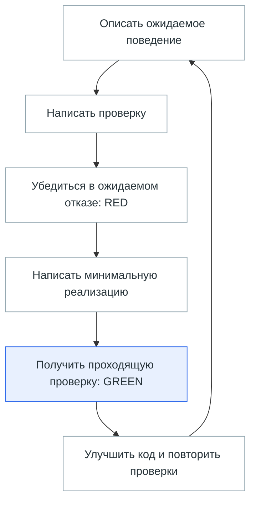

# Метод разработки с участием LLM

| Поле | Значение |
|---|---|
| Версия / дата | v0.2 / 2026-10-06; утверждённое правило от 2026-10-04 сохранено |
| Статус решения | APPROVED_BY_OWNER — «Хорошо. Утверждаем» после предложения метода в текущем диалоге |
| Область | Последующая разработка проекта Ai с участием LLM |
| Маршрут | FULL: запись утверждённого процессного решения |

Утверждённый метод: итерационно-инкрементальная разработка с контрольными точками; TDD по умолчанию для проверяемой программной логики. Для остальных работ способ проверки выбирается до реализации. Это процессное правило; оно не утверждает HLD/LLD, не разрешает ML-вызовы, установку, обработку корпуса или активацию нового поиска.

## Простыми словами

Метод описывает, как разрабатывать проект небольшими проверяемыми шагами с участием LLM. Сначала определяем ожидаемое поведение, затем проверяем его тестом и пишем код. Для схем, документов и модельных экспериментов выбираем подходящую проверку заранее.

TDD — разработка через тесты. RED означает, что тест обнаружил отсутствие нужного поведения; GREEN — поведение реализовано и тест проходит; REFACTOR — код улучшается при сохранении поведения.



Схема показывает успешный цикл для программной логики. Если проверка не прошла, работу возвращают к исправлению; к следующему поведению переходят после нужных проверок текущего шага.

**Пример.** Правило запрещает использовать один каталожный ноготь дважды. Сначала тест задаёт два ногтя запроса и один каталожный ноготь и проверяет, что совпадение назначено только одному. Затем появляется реализация. Ошибка импорта вместо проверки сопоставления не считается нужным RED.

## Рабочий цикл

1. Определить поведение и примеры из требования, включая существенные ошибки и границы.
2. Написать тест ожидаемого поведения. Ожидание следует из требования или независимого эталона, а не из проверяемого алгоритма.
3. Запустить тест: RED означает ожидаемый отказ из-за отсутствующего поведения. Ошибка импорта или конфигурации сама по себе не доказывает полезность проверки.
4. Написать минимальную реализацию, получить GREEN.
5. Улучшить код при проходящих тестах: REFACTOR.
6. Выполнить релевантные проверки интеграции и содержательное review по маршруту AGENTS. Новый отказ возвращает работу к исправлению.

LLM не ослабляет assert, не отключает и не удаляет проверку ради GREEN. Изменение ожидаемого поведения обосновывается изменением требования; исправление ошибочного теста обосновывается исходным требованием или независимым эталоном. Порядок «тест → код» не гарантирует независимость: смысл теста тоже проверяется.

## Применение к поиску по ногтям

| Работа | Проверка |
|---|---|
| Сопоставление, оценки, обработка ошибок, сессии | TDD на синтетических данных и заменителях внешних компонентов |
| Данные, repository и миграции | Test-first проверки инвариантов на отдельной тестовой БД; существующие операционные разрешения сохраняются |
| Совместимость ML и lifecycle | Заранее определённые технические пробы на реальных моделях после разрешения |
| Качество поиска | Заранее согласованные выборка, методика и критерии оценки выдачи |
| Визуальный интерфейс | Проверка в браузере; программная логика интерфейса покрывается поведенческими тестами по умолчанию |
| Документы, форматирование, обратимые малозначимые правки | Пропорциональная проверка результата; формальные unit-тесты не создаются без содержательного поведения для проверки |

Этапы реализации и открытые технические решения остаются в [LLD](architecture/nail-search-lld.md). Прохождение unit-тестов не доказывает улучшение выдачи. Исключение из test-first для конкретной работы объясняется её характером и выбранной проверкой, а не скоростью генерации кода. Отдельные агенты или новые согласования для каждого теста не вводятся.

## Обвязка агента и передача контекста

Обвязка — инструкции и инструменты, с которыми агент выполняет этот цикл. Их роли уже распределены:

| Источник | Для чего используется |
|---|---|
| [AGENTS.md](../AGENTS.md) и [governance](analysis/governance.md) | Выбор маршрута FAST_PATH/STANDARD/FULL, глубины чтения, проверки и необходимых утверждений |
| [Книжный пайплайн](book-guidance-pipeline.md) | Выбор правил для конкретного инженерного вопроса; без такого вопроса дополнительные книги не нужны |
| [LLD](architecture/nail-search-lld.md) | Предлагаемые контракты нового поиска, этапы реализации и существенные проверки |
| [План Mac](architecture/mac-common-environment-plan.md) | Подготовка и проверка совместимости реальных ML-компонентов |
| [Журнал задач](task-quality-journal.md) | Запись наблюдаемых результатов STANDARD/FULL, проверок и замечаний |

Для перехода в другой чат или продолжения после перерыва полезна короткая передача контекста. Пример ниже — формат записи, а не результат выполненной реализации и не новое требование создавать отдельный файл:

```text
Задача: сопоставление ногтей без повторного использования.
Где работали: фактические checkout, ветка и HEAD.
Сделано: конкретные изменённые файлы и поведение.
Проверено: команда, результат, существенные сценарии.
Не проверено: реальные модели, БД или качество, если не запускались.
Открыто: неизвестные параметры и решения владельца.
Следующий шаг: ограниченная задача и необходимое разрешение, если оно требуется.
```

Следующий агент сверяет текущее состояние с этой записью. Настоящие команды и результаты записываются после выполнения; пример нельзя переносить в журнал как evidence. Инструкции агенту не заменяют ограничения среды исполнения. Этот раздел связывает действующие источники и объясняет работу с ними; нового операционного разрешения не вводит.

## Исторический план-контракт и проверка v0.1 — 2026-10-04

Записать уже утверждённое предложение без расширения → добавить точные входные ссылки → проверить документ → один независимый read-only reviewer → исправить возможные отклонения записи. Утверждение метода получено до записи; повторного согласования его неизменного содержания не требуется.

Самопроверка: PASS — 13 относительных ссылок в документе/LLD, входная ссылка AGENTS, таблицы, fences, конфликтные маркеры и git diff --check. Независимое read-only review: PASS, 0 Critical / 0 Major / 0 Minor, `/root/nail_search_docs_review`, 2026-10-04. Исправлений не потребовалось. Код продукта, тесты, ML и БД этой задачей не запускались.
