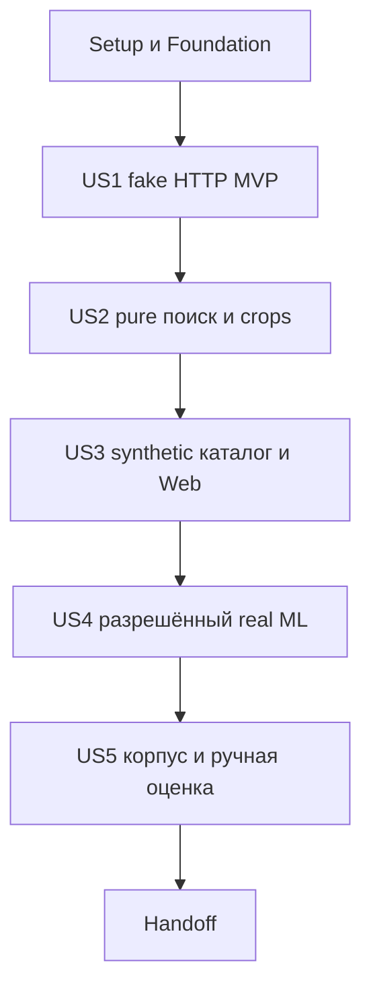

# Tasks: Candidate I HTTP и новый поисковый режим

**Input:** [spec](spec.md), [plan](plan.md), [research](research.md), [data model](data-model.md), [contracts](contracts/README.md), [quickstart](quickstart.md).

**Статус2026-10-09:** T001–T050 выполнены в описанных пределах; T050 — отдельно разрешённый [inventory Gate 2](build-readiness.md), 674 основных фото, без ML/build. T048 technical scenario PASS:2genuine full rounds/36vectors/41operations по [actual report](scenario-runtime-report.md). Owner «Принимаю» утвердил T049/actual G4 runtime в synthetic scope — [reference](runtime-profile-reference.md). Исторические strict REWORK сохранены. Один model window завершён; новые model calls требуют отдельного разрешения. Build/queries/activation сохраняют отдельные G5 permissions; Candidate J и Git publication не разрешены. [Execution-context](execution-context.md).

**Tests:** обязательный TDD по spec/методу. Каждая test task фиксирует ожидаемое поведение; RED должен быть связан с отсутствующим поведением, не ошибкой импорта/config. Допустим минимальный harness/stub для осмысленного RED. Implementation после соответствующего RED; verification — GREEN и релевантный Ruff. Данные и asserts не ослаблять ради прохода.

**Format:** `- [ ] Tnnn [P?] [USn?] действие с точным путём`. Tnnn/USn — локальные адреса чек-листа, не новые нормативные ID. `[P]` означает независимость файлов только после обозначенных prerequisites, не автоматическую авторизацию на дополнительные агентов.

## Глобальные ограничения и gates

- Все code/test пути относительно выбранного product checkout. Документы `specs/candidate-i-http/...` находятся в checkout документации; execution-context связывает два корня. Ветка документов сейчас codex/task-quality-journal; product branch ещё не выбран.
- Не импортировать I/Torch/DB/main.py в первый fake runner. Runtime HTTPX не считать установленным из его dev declaration; новые installs только после bill/разрешения.
- Approved wire: POST direct normalized RGB PNG; image 20 MiB, metadata 8 KiB, body 20 MiB+64 KiB; strict keys/identity, full-frame masks grayscale8 0/255; exact поля/codes — [контракт](../../docs/architecture/candidate-i-http-contract.md), не новые значения tasks.md.
- Нет auto POST retry/jobs, silent CPU fallback, image URL/SQL access I, автоматического NEW, J/Sheets/VM/users/categories.
- Query/admission/device/coordinator guards различны; actual executor держит device lease, backend не держит её при HTTP. Timeout/disconnect не освобождает actual resource; late result не commit.
- `G0`: до кода выбран writable checkout/ref, сохранено dirty state, доступны разрешённые dependencies и рассмотрен minimal wire→core DTO mapping плана. Отсутствующее не заполнять предположением.
- `G1`: до service dependencies/binding подготовки принят exact bill; fake testing не разрешает переписывать working I environment.
- `G2`: перед US2 приняты точные EXIF/RGB/bbox/cosine/precision/solver/tie детали LLD. Смысловые mean/missing0/white crop правила уже выбраны, но не все numeric поля.
- `G3`: [пакет schema/coverage/evidence/session и separate synthetic DB](g3-storage-decisions.md) APPROVED_BY_OWNER 2026-10-07. Owned DB identity проверена во всех fixtures; рабочая DB не стенд. [pgvector test package](g3-test-dependency-bill.md) отдельно разрешён и установлен. T032–T042 прошли scoped checks и final review; real CLI assembly остаётся за G4/G5.
- `G4`: APPROVED_BY_OWNER 2026-10-08: приняты bills/locks/models/fingerprints/finite runtime parameters; разрешены offline T044–T045 и bounded synthetic model operations T046–T048. Backend download не разрешён. Test values не production defaults.
- `G5`: T050 inventory Gate 2 отдельно разрешён и выполнен; build/примеры ещё требуют разрешений. Публикация/активация требует отдельного решения после coverage/оценки. Старые claims/evaluation не переиспользуются.

## Phase 1: Setup

- [x] T001 Зафиксировать selected checkout/ref, actual HEAD/dirty state, права записи, DOCUMENTATION_ROOT/IMPLEMENTATION_ROOT и сохранение existing изменений в `specs/candidate-i-http/execution-context.md`; не менять ветку и не создавать worktree молча только ради задач.
- [x] T002 Проверить read-only actual Python/test dependencies и canonical HTTP version/SHA; записать declared/source/installed различия и отсутствующие inputs в `specs/candidate-i-http/execution-context.md`; при отсутствии package STOP до разрешённого bill, не pip install.

## Phase 2: Foundational

**Gate:** G0. Только минимальный localization DTO/порт, не все роли LLD заранее.

- [x] T003 Добавить semantic RED cases в `tests/test_nail_contracts.py`: RGB bytes ровно width×height×3, mask bytes width×height, pixels 0/255, OK непустой/NO_NAILS пустой, immutable values и typed technical error; ожидаемые поля из LLD §4, без SDK objects.
- [x] T004 Реализовать согласованный минимальный mapping в `src/product_search/search/nail_contracts.py` и `src/product_search/search/nail_ports.py`: `NailLocalizationPort.localize(RgbImage, LocalizationProfile) → NailLocalization`; технический исход поднимает NailProcessingError. Получить GREEN T003; дополнительные порты пока не создавать.
- [x] T005 Добавить `tests/test_nail_dependency_boundaries.py`: AST imports этих core файлов ограничены stdlib/собственными DTO/ports; нет Pillow/HTTPX/experiments/Torch/DB/Web/settings, включая type hints. Проверять новые модули рекурсивно по мере появления.

## Phase 3: US1 — HTTP с fake-I (P1, первый increment)

**Goal:** доказать утверждённый обмен и отказ без моделей/БД. **Independent test:** real loopback fake server + client, correct pixels/masks/identity, BUSY/timeout/no retry и cleanup. **Prerequisites:** T001–T005, G1 перед server/dependency подготовкой.

- [x] T006 [US1] Написать RED codec cases в `tests/test_candidate_i_http_adapter.py`: RGB PNG round-trip без изменения pixels, metadata SHA относится к переданному PNG, api_version=1, UUID/canonical hex, exact width/height и две multipart parts, без original filename/URL/path.
- [x] T007 [US1] Реализовать PNG/multipart request codec в `src/product_search/infrastructure/nail_ml_adapters.py` и получить GREEN T006; image PNG RGB8 без alpha/EXIF, limits по контракту, не дублировать нормализацию ядра и не загружать providers.
- [x] T008 [US1] Добавить RED response cases в `tests/test_candidate_i_http_adapter.py`: OK regions непустой, NO_NAILS пустой, full-frame masks 0/255/nonempty, bbox bounds/ordinal, matching request_id/checksum/actual fingerprint; malformed Base64/PNG/лишний field/один invalid region отклоняет всё фото.
- [x] T009 [US1] Реализовать bounded response parser и wire→core mapping в `src/product_search/infrastructure/nail_ml_adapters.py`; проверить HTTP/body status-code agreement и все semantic constraints, получить GREEN T008.
- [x] T010 [P] [US1] Добавить RED transport cases в `tests/test_candidate_i_http_adapter.py`: все approved Problem codes, unknown status/code, connect/write/read/overall failure, redirects запрещены, одна POST попытка при timeout/Retry-After; error никогда не NO_NAILS.
- [x] T011 [US1] Завершить `HttpNailLocalizationAdapter.localize` в `src/product_search/infrastructure/nail_ml_adapters.py` с injected HTTPX client/test transport, finite injected parameters, ready identity check и утверждённым error mapping; получить GREEN T010, real I не подключать.
- [x] T012 [P] [US1] Добавить RED server cases в `tests/test_candidate_i_http_service.py`: /v1/localizations и /health/ready, exact multipart/body bytes caps, duplicate JSON keys/non-finite/unknown fields, invalid PNG/checksum/dimensions, fingerprint mismatch до injected binding, Problem/OK/NO_NAILS mapping.
- [x] T013 [US1] Реализовать facade `services/candidate_i/app.py` и параметризованную validation в `services/candidate_i/settings.py` с injected fake binding; получить GREEN T012 без model imports/bootstrap и без production defaults из fixtures.
- [x] T014 [US1] Написать RED concurrency/resource cases в `tests/test_nail_runtime.py`: query/admission/device/coordinator разные, два synthetic процесса, backend без device lock во время HTTP, второй admission BUSY, cancel/timeout не early release, invalid/missing parameters не ready; использовать events, не случайные sleep race assertions.
- [x] T015 [US1] Реализовать concrete guards/private root/path validation в `src/product_search/infrastructure/nail_runtime.py`; связать injected runtime с `services/candidate_i/app.py`, inference executor вне event loop; получить GREEN T014 и health/BUSY service cases, coordinator повторно I не захватывает.
- [x] T016 [US1] Добавить RED late/disconnect/exception/spool-cleanup cases в `tests/test_candidate_i_http_service.py`: native fake работа ещё держит admission/device после client disconnect, finally освобождает только своё; no masks/bodies/secrets в error/log.
- [x] T017 [US1] Дополнить service lifecycle в `services/candidate_i/app.py` и settings/private spool handling в `services/candidate_i/settings.py`; получить GREEN T016, не создавать queue/job/result store.
- [x] T018 [US1] Создать test-only `tests/support/candidate_i_fake_server.py` и `tests/test_candidate_i_http_loopback.py`: fixture запускает disposable subprocess на ephemeral loopback endpoint, real client→POST→fake result, гарантированный teardown; никакого real I, DB или production main.
- [x] T019 [US1] Выполнить US1 pytest/Ruff из `specs/candidate-i-http/quickstart.md`; записать actual commands/results и ограничения в `specs/candidate-i-http/execution-context.md`. MVP завершён только по actual GREEN, не по наличию файлов; model compatibility не заявлять.

## Phase 4: US2 — crops и поиск в памяти (P2)

**Gate:** G2; минимальные DTO и US1. **Independent test:** synthetic input/catalog и fake providers → deterministic top-10 с pure oracle, без DB/models.

- [x] T020 [US2] Написать RED decode/store и boundary cases в `tests/test_nail_image_store.py`: plain PhotoInput/RegionCrop/PhotoEmbeddings/PairMatch/read-catalog DTO и image/embedding/read-catalog ports из принятого G2; validated opaque ref/checksum/root, EXIF и alpha на white RGB, отсутствие symlink escape, private derivative ownership и cleanup.
- [x] T021 [US2] Реализовать US2 DTO/port declarations в `src/product_search/search/nail_contracts.py`, `nail_ports.py` и `src/product_search/infrastructure/nail_image_store.py`, получить GREEN T020; only external adapter использует Pillow/filesystem, query не сохраняет disk crops. Все эти DTO доступны до solver/provider/service tasks, физическая schema ещё не реализуется.
- [x] T022 [US2] Добавить RED processor cases в `tests/test_nail_image_processor.py`: same query/catalog profile, half-open bbox по mask, white pixels вне mask, ordered regions, один invalid region → whole-photo error, NO_NAILS не фильтр качества.
- [x] T023 [US2] Реализовать `src/product_search/search/nail_image_processor.py` с injected image/localization ports и plain byte crops; получить GREEN T022, без HTTP/Pillow/I imports.
- [x] T024 [P] [US2] Добавить RED solver cases в `tests/test_nail_matching.py`: greedy trap, n<m/n=m/n>m, no repeats, missing0, mean трёх моделей, одинаковые/нулевые сходства, stable ties и independent exhaustive oracle малых матриц; exact numeric values только из принятого G2.
- [x] T025 [US2] Реализовать `src/product_search/search/nail_matching.py` по принятому cosine/precision/subset-DP/tie profile и finite solver budgets; получить GREEN T024, без I/O и дополнительных algorithm dependencies.
- [x] T026 [P] [US2] Добавить RED fake-provider cases в `tests/test_nail_embedding_adapter.py`: исходный crop order, полный набор 512/768/768, finite/nonzero vectors, mismatched revision/dimension отказ; нет silent degraded model set.
- [x] T027 [US2] Реализовать embedding facade в `src/product_search/infrastructure/nail_ml_adapters.py` с injected provider factories; получить GREEN T026, без real model load и eager Torch import при client-only tests.
- [x] T028 [US2] Написать RED ranking cases в `tests/test_nail_service.py`: закреплённая representation, INDEX_EMPTY до ML, лучший ракурс/без bonus duplicates, up to 10 unique products, score не вероятность, errors не partial run; fake catalog/provider/image ports.
- [x] T029 [US2] Реализовать `src/product_search/search/nail_service.py` и только необходимые now port DTO в `src/product_search/search/nail_ports.py`; получить GREEN T028, не принимать ORM/request/path objects в core.
- [x] T030 [US2] Расширить `tests/test_nail_dependency_boundaries.py` на processor/matcher/service, включая indirect concrete imports/type hints; проверить отсутствие numeric/scoring в Web/adapters и сборку concrete dependencies снаружи.
- [x] T031 [US2] Запустить US2 tests/Ruff и сохранить результаты в `specs/candidate-i-http/execution-context.md`; synthetic score correctness не объявлять подтверждением real top-10 качества.

## Phase 5: US3 — каталог, evidence и Web (P3)

**Gate:** G3 и US2. **Independent test:** отдельная synthetic DB + Web doubles, legacy regression и atomic state. Нельзя запустить integration tests без проверки DB identity.

- [x] T032 [US3] Написать RED migration constraint cases в `tests/test_nail_migration_integration.py`: mandatory NOT NULL, model dimensions/ownership/FK, READY immutability, empty upgrade→downgrade→upgrade, populated downgrade отказ без потери данных; synthetic DB only после G3.
- [x] T033 [US3] Создать `migrations/versions/nail_search_v1.py` с unique revision/down_revision по actual head и принятой additive schema LLD §9/12; не переписывать старые migrations, получить GREEN T032 на разрешённой DB, не применять к действующей.
- [x] T034 [US3] Добавить RED repository cases в `tests/test_nail_repository.py`: atomic photo writes, full three-model set, all-NO_NAILS/ERROR не publish, compare-and-set active pointer, pinned identity/corpus, READY read-only.
- [x] T035 [US3] Реализовать `src/product_search/infrastructure/nail_repository.py` и соответствующие DTO/ports в `src/product_search/search/nail_contracts.py`, `nail_ports.py`; получить GREEN T034, SQL constraints остаются внешней защитой core readiness policy.
- [x] T036 [US3] Написать RED build cases в `tests/test_nail_catalog_build.py`: заранее разрешённый inventory/ownership/profile, terminal outcomes, private artifact refs, минимум OK и coverage; no download и no automatic publish.
- [x] T037 [US3] Реализовать `src/product_search/search/nail_catalog_build.py` и `scripts/build_nail_representation.py` по принятому G3, получить GREEN T036 с doubles; build command ещё не запускать на corpus.
- [x] T038 [US3] Добавить RED evidence cases в `tests/test_nail_evidence.py`: explicit mode/representation/score_kind/search_payload identity, legacy RRF сохранён, approved NOT NULL/consistency constraints и единая transaction rollback.
- [x] T039 [US3] Реализовать mapping/finalize port в `src/product_search/infrastructure/evaluation_repository.py` и integration в `src/product_search/search/evaluation.py`; получить GREEN T038, новый score не помещать в rrf_score.
- [x] T040 [US3] Написать RED Web/session cases в `tests/test_nail_web.py`: existing routes/limits, NEED_MORE без NEW, pending после первого success, additional меняет input revision, failed rerun сохраняет candidates/labels но stale finalize запрещён, success reset labels, late response не commit.
- [x] T041 [US3] Обновить `src/product_search/web/app.py`, `search/multiphoto.py`, `search/evaluation.py`, `main.py` для explicit new-mode wiring/executor/staged commit; получить GREEN T040 через create_app с doubles, /search не проксирует internal Problem raw body.
- [x] T042 [US3] Выполнить US3 и релевантные existing upload/multiphoto/evaluation/retention/legacy regressions, результаты сохранить в `specs/candidate-i-http/execution-context.md`; полный integration suite без target DB authorization не запускать.

## Phase 6: US4 — реальные I и providers (P4)

**Gate:** G4, US1 guards и US2/US3 contracts. **Independent test:** разрешённая generated RGB серия доказывает технический HTTP/ML профиль, не поиск товаров.

- [x] T043 [US4] Подготовить read-only actual inventories и exact proposed backend/I bills, model/lock/code identity, конечные deadlines/decoded-pixel/region/response/solver/memory parameters в `specs/candidate-i-http/runtime-bill.md`; public версия только безопасные агрегаты, private paths/полный inventory остаются вне Git; запросить недостающие permissions до real операций.
- [x] T044 [US4] После G4 declaration/install разрешения добавить runtime HTTPX в `pyproject.toml` и exact I web dependencies в `services/candidate_i/requirements.lock`; сохранить контрольный I runtime, не merged lock; freeze/import checks не назвать model smoke. Rework/addendum approved: fresh env89 inventory/VCS/model hashes PASS, service lock SHA013ba67f...; old control/clone сохранены.
- [x] T045 [US4] Реализовать lazy real binding `services/candidate_i/binding.py` через existing LangSAMAdapter/normalize_result и тесты `tests/test_candidate_i_binding.py` с fake imports/results, по RED→GREEN; paths/config/allowlist внешние, никаких calibration/J runners.
- [x] T046 [US4] После explicit load/model разрешения выполнить и сохранить technical I/HTTP outcomes в `tests/test_candidate_i_real_smoke.py` и `specs/candidate-i-http/runtime-report.md`: generated detector path, отдельный synthetic SAM, fingerprint/profile mismatch до ML, masks в source frame; NO_NAILS на generated RGB допустим, не заменяет SAM проверку.
- [x] T047 [US4] Проверить три existing providers на synthetic crop в `tests/test_nail_real_providers.py`, сохранить finite L2 512/768/768 и actual revisions/device в `specs/candidate-i-http/runtime-report.md`; не использовать старые evaluation фото или claims.
- [x] T048 [US4] Проверить bounded HTTP I→crop→providers lifecycle, shared guards, timeout/cleanup и memory residency двух процессов по `specs/candidate-i-http/quickstart.md`; actual resource/time агрегаты записать в `specs/candidate-i-http/runtime-report.md`, без raw masks/images и без silent CPU fallback. По отдельно утверждённым [policy](scenario-suitability-profile.md)/[bill](scenario-probe-plan.md),2026-10-09: [actual report](scenario-runtime-report.md) —2genuine rounds/36vectors/41operations/29.879с, hardSTOPнет; nativeconcurrencyfault/timeout injection не проводились, controlledfakeguards evidence отдельно. Technical scenarioPASS; T049/G4owneracceptance/G5 не закрыты.
- [x] T049 [US4] После проверки предъявить runtime report владельцу и закрепить принятый runtime/extractor fingerprint в `specs/candidate-i-http/runtime-profile-reference.md`; actual private runtime config вне Git.2026-10-09 «Принимаю»: reference6cccc473... и private source/config/profile snapshot зафиксированы; G4runtime accepted in syntheticscope, G5/data inventory/build/activation не разрешены автоматически.

## Phase 7: US5 — корпус и ручная оценка (P5)

**Gate:** G5 и принятый US4 profile. **Independent test:** разрешённые corpus build/queries и owner evaluation. Publish/activation отдельно от окончания вычисления.

- [x] T050 [US5] После отдельного inventory разрешения проверить доступность/принадлежность всех каталожных фото и freeze входов для `scripts/build_nail_representation.py`; сохранить безопасные coverage prerequisites в `specs/candidate-i-http/build-readiness.md`, без source data/полных IDs/paths. 2026-10-09: выбранный Gate 2 primary scope, 674/674 files/hash match, 667 уникальных hashes, приватный manifest; без decode/ML/build, T051 permission остаётся отдельным.
- [ ] T051 [US5] После explicit build permission запустить actual frozen `scripts/run_nail_native_build.py --execute` один раз в утверждённом profile; отдельная BUILDING representation, terminal outcomes и production data не перезаписаны; безопасный итог в `specs/candidate-i-http/build-report.md`. 2026-10-09: [подготовка без ML](build-preparation-report.md), persistent target/674 parent rows; [generic composition и exact fake command](build-composition-report.md) проверены отдельно. На2026-10-09 Native BLOCKED_INPUT_POLICY (673decodeOK/1oversize).2026-10-11: [отдельный approved набор674](oversize-input-report.md) подготовлен,674decodeOK; Прежний674package подготовлен, затем owner сократилfirsttest до[100fixedinputs/list/newjob](corpus-100-report.md);100model-freecheckPASS; затем owner разрешилoneMLwindow. [Actualbuild](build-report.md):26.61s/pressure4STOP/PENDING100/noindex, окноиспользовано, autorestartзапрещён. Затем [ownerfreshattempt](build-retry-report.md) после закрытияприложений:6OK/94PENDING/31regions93vectors, observerSTOP; гонканаблюдателя исправлена/model-freepackage готов, Затем [approvedobserverfixrun](build-observerfix-run-report.md):17OK/1NO_NAILS/82PENDING/LOCALIZATION_STOP;causecode logging исправлен, [one-photo019probe](photo019-diagnostic-report.md) разрешён иисполнен:16,82s/RESOURCE_ERROR/PENDING1; вероятное превышение10regions, точнаяветвьUNKNOWN; окноиспользовано. Затем [owner-approvedskip-photo100](skip-photo-build-report.md):20OK/1NO_NAILS/1ERROR/78PENDING,115,634s/pressure4STOP;фото019REGION_COUNT_LIMITпропущено,новоеокноиспользовано.
- [ ] T052 [US5] Предъявить coverage/error/готовность из `specs/candidate-i-http/build-report.md` владельцу: исключённый товар не считается правильным NEW; переход к publish только отдельным решением, неполный/пустой индекс не READY.
- [ ] T053 [US5] С владельцем определить разрешённые обычные проверочные queries и сохранить только безопасную методику в `specs/candidate-i-http/manual-validation.md`; не вводить обязательный baseline benchmark, сложную выборку или новые допустимые проценты ошибок.2026-10-11: owner выбрал[manual20методику](manual-validation.md),[отдельныйстенд20](manual-quality20-report.md)готов;actualownerqueries/quality ещёUNKNOWN;canonicalfull100T053/T054 не закрыты.
- [ ] T054 [US5] Провести разрешённую ручную проверку готовой выдачи и записать observed top-10/желательный top-3, SAME_PRODUCT/NEW и дефекты в `specs/candidate-i-http/manual-validation.md`; успех примеров не гарантия любых future фото, owner результат не подменять self-check.
- [ ] T055 [US5] Выполнить publish/activation или оставить build непубликуемым строго по отдельному решению владельца через `scripts/build_nail_representation.py`; зафиксировать safe representation/pointer/rollback identity в `specs/candidate-i-http/activation-report.md`, не удалять old corpus/embeddings/evidence.

## Final Phase: Polish и handoff

- [ ] T056 Синхронизировать только фактически реализованные interfaces/статусы в `docs/architecture/nail-search-hld.md`, `docs/architecture/nail-search-lld.md` и текущем `specs/candidate-i-http/execution-context.md`; не присваивать implementation/render/quality PASS по tests одного этапа.
- [ ] T057 Выполнить relevant final tests/Ruff/link/diff checks и сохранить actual команды/results/оставшиеся gates в `specs/candidate-i-http/execution-context.md`; передать ограниченный следующий шаг и journal entry по AGENTS, без auto commit/push/merge.

## Бэклог

- [ ] Исследовать ускорение локализации и эмбеддингов: stage timings, batch crops,
  необходимость3models иsecondROIpass. **Отложено владельцем2026-10-11 до проверки
  качества результата обновлённой системы**. Сейчас не запускать profiling/model
  probes и не менять алгоритм, модели или batch policy; возвращаться отдельной задачей.

- [x] Выбрать и отдельно согласовать обработку одного фото1802×1802, превышающего
  cap2359296pixels. Отложено владельцем2026-10-09; возобновлено2026-10-11 и способ
  отдельно утверждён ответом «разрешаю»: новая1536×1536копия,674positions, original
  и current cap сохранены. [Результат подготовки](oversize-input-report.md):
  673byte-identical/1transformed/674decodeOK, original manifest unchanged.
  Scope решения — offline input preparation; T051/native execution/publish открыты.

## Dependencies и порядок завершения

- US1: T003 → T004 → T005; T006→T007→T008→T009→T010→T011; T012→T013; T014→T015→T016→T017; T018 после client/server/guards, T019 после всех US1.
- US2: T020→T021→T022→T023; после T021 независимые T024→T025 и T026→T027; T028→T029 после processor/matcher/embedding; T030→T031 завершает story.
- US3: T032→T033→T034→T035; T036→T037 и T038→T039 после agreed data ports/schema; T040→T041 после core/ports; T042 после всех.
- US4: T043 → принятие bill/G4 → T044; T045 может быть fake-tested до model calls, T046–T048 после permissions; T049 после observed результатов.
- US5: T050 → build permission → T051→T052; T053→T054 после разрешения примеров/доступной representation; T055 только после отдельного publish/activation решения.

Наличие task в списке не закрывает внешний gate. При незакрытом gate executor оставляет checkbox пустым, фиксирует точный отсутствующий input и продолжает только независимую разрешённую работу. Артефакты исполнения с private входами публично не заполняются.

## Возможности параллельной работы

| Story | Независимые ветви после prerequisites | Ограничение |
|---|---|---|
| US1 | После T009 client-negative tests T010 и server tests T012 в разных файлах | Реализация общего runtime/adapter последовательно; авторы автоматически не запускаются |
| US2 | После G2 и T021 pure solver tests T024 и fake embedding tests T026 | T025/T027 зависят от своего RED; T027 не параллелен другим edits nail_ml_adapters |
| US3 | После data interfaces build tests T036 и evidence tests T038 | Не отмечены [P]: DB target/fixtures могут разделять состояние, по умолчанию последовательно |
| US4 | Read-only bill можно готовить независимо от early fake этапов | Real model calls/общий device строго последовательно |
| US5 | Параллельного data/model выполнения нет | Операции отдельно разрешены, одна approved серия |

## Implementation strategy и проверка полноты

MVP — Setup/Foundation/US1 (T001–T019): real HTTP с fake I и guards, не готовый search продукт. Затем increments US2–US5 с указанными gates. Сначала тесты ожидаемого поведения, потом минимальная реализация и GREEN; [quickstart](quickstart.md) задаёт соответствующие commands и expected outcomes.

План/spec/data-model/контракт покрываются пятью story phases; tuple/image/model/representation/session invariants проверяются в владельце соответствующего кода. Local labels и proposed paths не утверждают новые нормативные решения. Story breakdown: US1 14, US2 12, US3 11, US4 7, US5 6; shared setup/foundation 5, polish 2; всего 57 задач.
