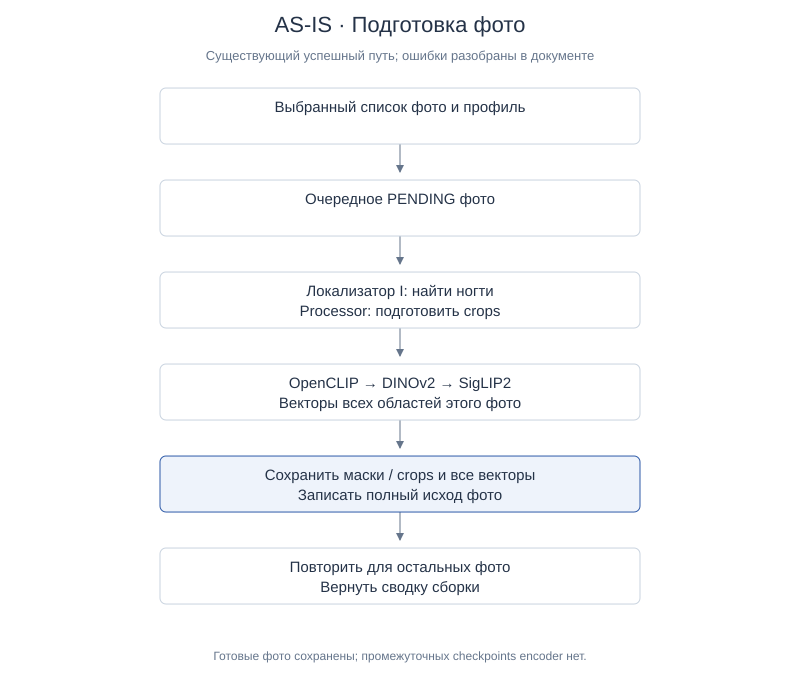
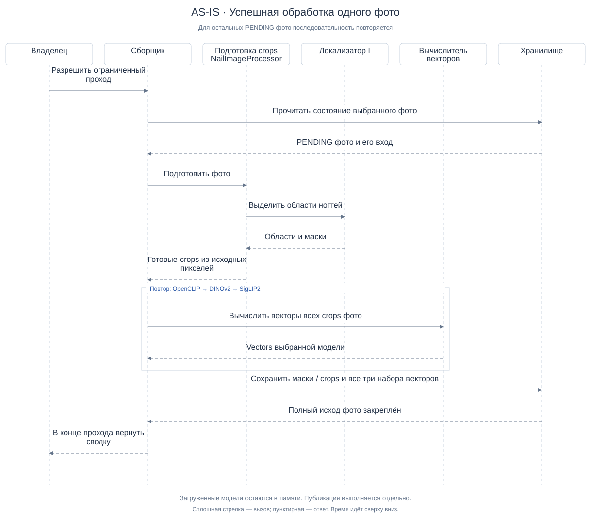

# AS-IS — подготовка поискового корпуса

| Паспорт | Значение |
|---|---|
| Дата / версия | 2026-10-12 / v1 |
| Назначение | Объяснить стороннему аналитику существующую обработку фото и её ограничения |
| Статус | Описание проверенного кода и сохранённых результатов; не новый runtime-замер |
| Граница | От выбранного списка фото до результата сборки; публикация описана как отдельное действие |
| Основания | [Сводка исследования](research-summary.md), отчёты и source mapping в разделе9 |

## 1. Контекст и цель

AI-поиск помогает найти в каталоге тот же или похожий товар по фотографии.
Для этого фотографии каталога сначала нужно подготовить: выделить ногти,
получить их численные представления и сохранить результаты. Эту подготовку
мы называем **сборкой поискового корпуса**.

Документ описывает сборку, а не пользовательскую загрузку запроса. Для запроса
также нужны выделение ногтей и векторы, но его обработка не добавляет товар в каталог.

## 2. Основные понятия

| Термин | Простое объяснение |
|---|---|
| Товар | Позиция каталога; у неё может быть несколько фотографий |
| Фото | Один ракурс или изображение товара |
| Область ногтя | Найденная на фото часть, которую система будет сравнивать |
| Маска | Обозначение пикселей, принадлежащих найденной области |
| Crop | Изображение выделенного ногтя, вырезанное из исходного фото; фон вне маски белый |
| Вектор / embedding | Набор чисел, описывающий изображение для сравнения |
| Локализатор I | Обработчик, который находит ногти и возвращает их области |
| Encoder | Модель, которая преобразует crop в вектор; используются OpenCLIP, DINOv2 и SigLIP2 |
| Корпус / представление | Подготовленные изображения и векторы, связанные с версией обработки |
| Публикация | Отдельное переключение поиска на проверенное подготовленное представление |

Фото, товары и области — разные единицы. Одно фото может дать несколько областей,
а один товар — несколько фото. Число 20 в текущем тестовом каталоге не является
техническим пределом системы.

## 3. Участники и ответственность

Эти названия обозначают логические роли. Участник «Хранилище» объединяет файловые
артефакты и записи БД для читаемости схемы; это не утверждение об одном сервисе.

| Участник диаграмм | Что делает | Связь с реализацией |
|---|---|---|
| Владелец | Разрешает конкретный ограниченный проход и рассматривает результат | Человек, не автоматический retry |
| Сборщик | Проверяет профиль, выбирает очередное фото, вызывает обработчики и сохраняет исход | `NailCatalogBuildService` |
| Локализатор I | Возвращает координаты, маски, label и confidence найденных областей; готовые crops не возвращает | HTTP I, `CandidateIBinding` |
| Подготовка crops | Читает исходное фото, вызывает I и создаёт crops по полученным маскам | Backend, `NailImageProcessor` |
| Вычислитель векторов | Последовательно запускает три encoder для crops | `NailEmbeddingAdapter` и providers |
| Хранилище | Хранит исходы фото, masks/crops и vectors | Каталожный repository и файловый адаптер |

Resource guard наблюдает за нагрузкой и может остановить собственные процессы
прохода. На диаграмме успешной обработки он не показан; остановки описаны в разделе6.

## 4. Входы и результаты

На входе — выбранный упорядоченный список фото и фиксированный профиль:
модели, их версии, подготовка изображений и ресурсные ограничения. Контрольная
сумма SHA позволяет обнаружить изменение файла; проверка профиля защищает от
смешивания несовместимых результатов.

Для успешного фото сохраняются области, masks/crops и векторы всех трёх моделей.
Для фото без найденных ногтей — отдельный исход `NO_NAILS`. Ошибка фото сохраняется
как `ERROR` с причиной. Необработанное фото остаётся `PENDING`.

## 5. Основной сценарий

[Редактируемый PlantUML-исходник](diagrams/as-is-overview.puml).
Схема показывает успешный путь; варианты ошибок описаны ниже.

1. Сборщик проверяет список фото и совместимость профиля. Для нового прохода
   создаёт записи сборки; для продолжения сверяет прежнюю identity.
2. Берёт очередное `PENDING` фото, проверяет и декодирует его.
3. Сборщик вызывает backend processor. Тот отправляет изображение локализатору I
   и получает области с координатами и масками, label и confidence. I не возвращает
   готовые crops. `NailImageProcessor` находит минимальный прямоугольник каждой
   маски, копирует исходные пиксели ногтя, а фон вне маски делает белым.
4. OpenCLIP вычисляет векторы всех crops этого фото. Затем то же делают DINOv2
   и SigLIP2. Модели вызываются последовательно.
5. После получения полного набора vectors файловый адаптер сохраняет masks/crops,
   а repository записывает итог фото. Только теперь успешное фото получает `OK`.
6. Сборщик переходит к следующему фото и в конце возвращает сводку.

[Редактируемый PlantUML-исходник](diagrams/as-is-sequence.puml).

Providers загружаются по мере первого использования и остаются в памяти.
Локализатор работает в отдельном процессе. Поэтому последовательные вызовы
не означают, что в памяти находится только одна модель. Image-only изменение
убирает постоянное удержание текстовых ветвей OpenCLIP/SigLIP2, но не выгружает
их image encoder после каждого фото.

## 6. Ошибки, остановки и продолжение

| Ситуация | Текущее поведение |
|---|---|
| Ногти не найдены | Записывается `NO_NAILS`; векторы этого фото не вычисляются |
| Обработчик вернул разрешённый отказ результата фото | Записывается `ERROR`; проход может перейти к следующему фото. Не каждый отказ разрешён к пропуску |
| Критическое давление памяти, недоступные/устаревшие измерения или другая общая ошибка контроля | Проход останавливается; автоматического restart нет |
| Фото уже полностью готово | При разрешённом resume оно не пересчитывается; исходник и артефакты проверяются |
| В сборке есть `ERROR` | Обычный resume отвергается: требуется явное решение о повторной обработке |
| Остановка внутри успешной обработки фото | Checkpoint после отдельных encoder отсутствует; готовые промежуточные результаты нельзя надёжно переиспользовать как завершённую стадию |

**Готовые фото уже сохраняются отдельно.** Нельзя говорить, что остановка теряет
весь проход. Пробел касается обработки внутри ещё не завершённого фото.
Остановка по общему ограничению ресурсов не превращается в обычную ошибку фото.

## 7. Когда данные доступны в поиске

Сборка и публикация — разные операции. `publish` проверяет полноту и покрытие
товаров, после чего может переключить active representation. Неполная сборка
не становится готовой по факту завершения процесса.

Последний build100 имеет 20 OK / 1 NO_NAILS / 1 ERROR / 78 PENDING и не опубликован.
Для ручной проверки подготовлен отдельный immutable subset20 с собственным
read-only представлением. Его готовность не означает готовность исходного набора из 100 фото.

## 8. Ограничения и подтверждённая проблема

Проход на 100 фото остановился при критическом давлении на память (`pressure=4`). RSS собственных процессов оставался ниже установленных потолков; точный источник системного давления UNKNOWN. Одновременная резидентность моделей — гипотеза, а не установленный виновник.

Основные ограничения: удержание нескольких providers, отсутствие промежуточных
checkpoints и отдельный unresolved retry для `ERROR`. Небольшие успешные пробы
не доказывают длительную устойчивость. Сравнение 7 комбинаций на 3 запросах не
выделило слабую модель и не разрешает удалить одну из них.

## 9. Основания и проверка

- Source: `NailCatalogBuildService.execute/publish`, `NailEmbeddingAdapter.encode`
  в сохранённом checkout `corpus-optimization`. Полной product реализации в
  текущем checkout документации нет; описание не выводится из его старой базы.
- [Предложение пополнения: описание AS-IS](../candidate-i-http/incremental-corpus-proposal.md#что-происходит-сейчас).
- [Последний проход100](../candidate-i-http/skip-photo-build-report.md).
- [Диагностика памяти](../candidate-i-http/memory-pressure-diagnosis.md).
- [Результат image-only загрузки](../candidate-i-http/image-only-load-report.md).
- [Сравнение моделей и границы выборки](model-ablation-report.md).

Source подтверждает порядок обработки, но не новую runtime-проверку. Сведения
о memory STOP подтверждены в границах сохранённых отчётов. Данные, IDs товаров,
секреты и приватные изображения в документ не включены.

План-контракт пакета: сверить AS-IS с source → описать DRAFT TO-BE и открытые
решения → подготовить 5 пар диаграмм → проверить смысл/ссылки/визуальное отображение →
один независимый read-only reviewer → исправить замечания → предъявить владельцу.
Новые численные NFR, ML-окна, изменения кода и публикация не входят.

Проверки и review всего пакета фиксируются в [TO-BE, разделе9](to-be.md#9-проверка-проекта-и-источники).
