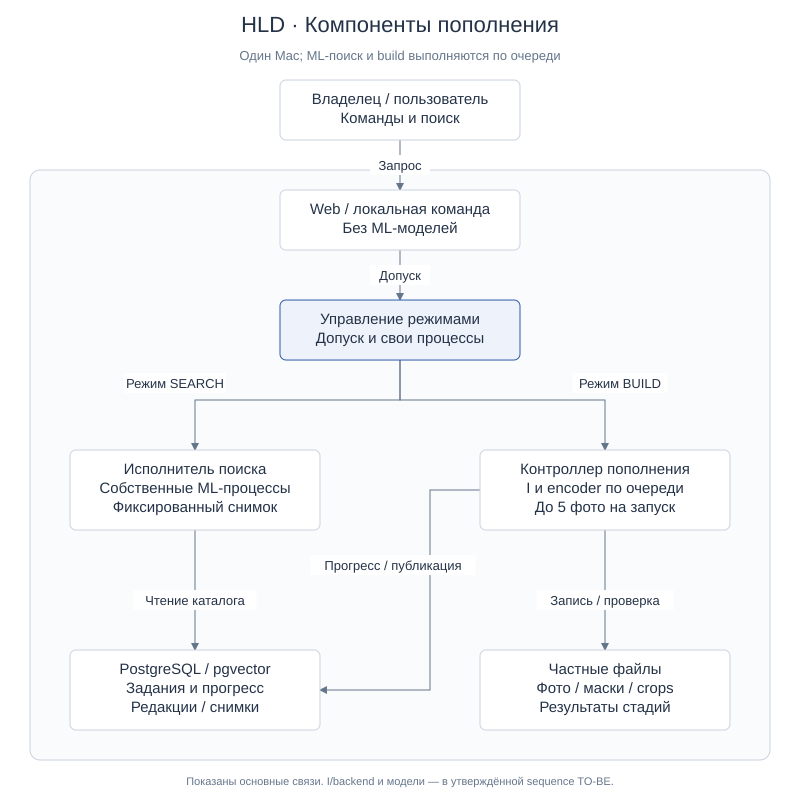
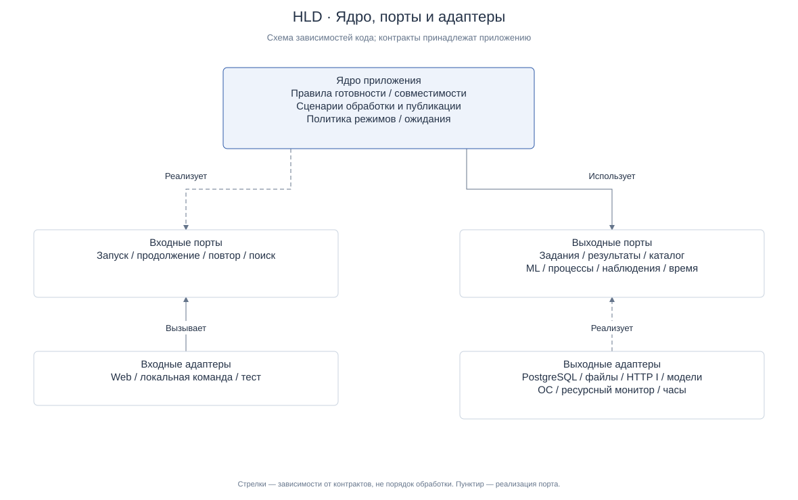
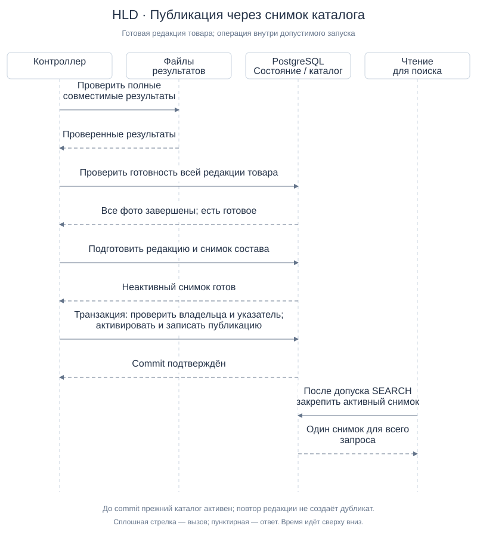

# HLD — пополнение поискового корпуса

| Паспорт | Значение |
|---|---|
| Версия / дата | v1.1 / 2026-10-12 |
| Статус | `APPROVED_BY_OWNER` — владелец утвердил HLD v1.1 сообщением «Утверждаю» 2026-10-12 после review и исправлений |
| Входы | [TO-BE v2](to-be.md) и [функциональные требования v1](functional-requirements.md), APPROVED_BY_OWNER |
| Область | Один Mac, выбранный существующий корпус, три модели, пополнение по стадиям |
| Выход | Границы компонентов, данные, потоки, публикация, отказоустойчивость и маршрут реализации |

## 1. Простыми словами

HLD — описание общего устройства решения. Здесь показано, какие части нужны,
за что они отвечают и как обеспечивают утверждённое поведение. Поля таблиц,
SQL, форматы сообщений и конкретные классы относятся к LLD/техническому плану.

Предлагается сохранить приложение, PostgreSQL/pgvector, файловое хранилище и модели.
Лёгкая управляющая часть остаётся доступной, а тяжёлая работа выполняется в
собственных процессах: либо поиск, либо пополнение. Прогресс хранится в БД;
маски, crops и промежуточные результаты — в частном файловом хранилище.

Готовность определяется для каждого товара, даже если его фото попали в разные
партии. Готовый товар публикуется автоматически. Для этого новый снимок состава
каталога ссылается на неизменяемые готовые редакции товаров; старые векторы
не пересчитываются при добавлении нового товара.

Все новые механизмы ниже — архитектурные предложения, а не подтверждённая
реализация. Ни экономия RAM, ни длительная устойчивость этой схемы ещё не измерены.

### План-контракт

Сверить требования с исходным кодом, выделить компоненты и транзакционные границы,
сопоставить варианты публикации, подготовить диаграммы и трассировку функций,
провести структурную/визуальную проверку и одно независимое read-only review.
После исправлений владелец утвердил HLD v1.1; следующий этап — отдельный LLD/технический план.
Код продукта, ML, данные, миграции, публикация, merge/push не запускаются.

## 2. Основания и разрыв с текущей реализацией

Требования и TO-BE прочитаны в рабочей ветке `codex/upload-optimiz`. Исходный код
поиска по ногтям проверен в сохранённом checkout `corpus-optimization`, HEAD
`ba49504`, с локальными изменениями. Это чтение source, не проверка запущенного
сервиса и не подтверждение переноса реализации в рабочую ветку.

| Сейчас подтверждено в source | Что требуется изменить |
|---|---|
| NailCatalogBuildService выполняет всю цепочку для фото, затем сохраняет исход | Разделить стадии и закреплять промежуточный результат |
| ERROR препятствует обычному resume | Различить продолжение незавершённого и ручной повтор ошибки |
| Providers удерживаются после загрузки | Добавить проверяемое управление процессами и резидентностью |
| Репозиторий публикует целый READY representation | Добавить единицу готовности/публикации «редакция товара» |
| Чтение каталога и runtime связываются одним representation_id/fingerprint | Явно поддержать снимок каталога и проверку его совместимости |
| POSIX leases защищают операции и одного владельца | Добавить исключение режимов поиска/build на весь срок резидентности |

Точные source-локаторы находятся в разделе 12. Старый
[HLD поиска по ногтям](../../docs/architecture/nail-search-hld.md) используется
как контекст, а не как полностью утверждённая архитектура. Его прежний запрет
«новая очередь не входит» относится к тому scope; здесь очередь разрешена TO-BE.
Контракт HTTP I и принятый алгоритм поиска сохраняются.

## 3. Ограничения, влияющие на архитектуру

- До 5 фото на запуск; фото одного товара могут оказаться в нескольких запусках.
- Локализация/crops, OpenCLIP, DINOv2, SigLIP2 — последовательные тяжёлые стадии.
- Поиск и build работают по очереди. Простая блокировка вызова не освобождает модели.
- Warning: ожидание до 5 минут, в пределах окна; продолжение после 30 секунд
  допустимых свежих наблюдений. Critical/unknown/stale имеют приоритет и дают STOP.
- Ошибка фото завершает попытку; повтор только вручную. Сбой общей БД/хранилища останавливает запуск.
- Все выбранные фото завершены и хотя бы одно готово — товар можно публиковать.
- Публикация автоматически включает только полные совместимые фото одной редакции.
- Ограничения claims, исходных данных, профилей и отдельного разрешения запуска сохраняются.

Это краткие ссылки на [ФТ](functional-requirements.md), не новые бизнес-правила.

## 4. Компоненты и размещение

[PlantUML-исходник](hld-diagrams/components.puml). Схема показывает основные
связи; общий PostgreSQL содержит и прогресс, и опубликованный каталог.

| Компонент | Ответственность / граница |
|---|---|
| Web / локальная команда владельца | Принимают запросы, показывают занятость/сводку; не загружают ML-модели |
| Управление режимами | Владеет запуском, запрещает пересечение поиска/build, запускает и останавливает только свои процессы |
| Контроллер пополнения | Выбирает до 5 фото, координирует стадии, сохранение, готовность и публикацию |
| Исполнитель локализации | Собственный процесс с I в его окружении; прежний HTTP-контракт; backend создаёт crops |
| Исполнитель encoder | Собственный процесс одной модели в основном окружении; читает crops последовательно |
| Исполнитель поиска | Отдельный управляемый ML-процесс; существующий алгоритм над закреплённым снимком каталога |
| Работа с результатами | Проверяет файлы и checkpoints, изолирует частичные результаты; не решает готовность товара |
| Публикация каталога | Готовит снимок состава и атомарно активирует его; проверяет текущую редакцию и владельца запуска |
| PostgreSQL / pgvector | Задания, попытки, исходы, checkpoints, редакции, векторы, снимки и активный указатель |
| Частное файловое хранилище | Исходные фото, маски/crops, промежуточные векторы и сводки вне Git |
| Наблюдение ресурсов | Даёт достоверный сигнал из действующего профиля; не устанавливает новые пороги |

Это логические обязанности внутри существующего приложения, а не один новый
микросервис на каждую строку. Контроллер и публикация не загружают модели.
I и encoder сохраняют свои зависимости/locks; общего ML-окружения не вводим.

Основной набор правил — Clean Architecture mini: правила готовности и допуска
не зависят от SQL, файлов или HTTP. Существующие порты расширяются только для
необходимых операций; отдельный framework или слой «на будущее» не нужен.
Implementing DDD mini применяется к редакции товара и границе атомарной публикации;
событийный брокер, Event Sourcing и CQRS не вводятся.

### 4.1. Гексагональная граница: ядро, порты и адаптеры

[PlantUML-исходник](hld-diagrams/ports-adapters.puml).
Это схема зависимостей программного кода, а не схема процессов из раздела 4.
Ядро зависит от договоров — портов. Выходные адаптеры реализуют эти договоры;
входные адаптеры вызывают сценарии, которые ядро предоставляет через входные порты.
Поэтому стрелки направлены к портам: это не порядок передачи запроса.

**В ядре:** правила готовности фото/товара, совместимости профиля, допустимости
повтора и публикации; сценарии запуска, продолжения, повтора и поиска;
политика переключения режимов и ограниченного ожидания. Сценарии координируют
операции через порты. Они не импортируют PostgreSQL, HTTP-клиент, PyTorch,
framework Web, файловую систему или функции управления процессами ОС.

**За границей ядра:** преобразование Web/CLI-запроса в команду, SQL и транзакции,
чтение/запись файлов, HTTP I и вызовы моделей, процессы и leases, наблюдение
нагрузки и получение времени. Эти детали возвращают простые данные приложения,
а не cursor/ORM-объект, HTTP response, tensor, PID-handle или дескриптор файла.
Числовые векторы и найденные области проходят границу в согласованном виде.

Два разделения особенно важны:

- Сценарий публикации проверяет готовность и выбирает редакцию. Адаптер PostgreSQL
  выполняет атомарную активацию и проверяет версии/владение/целостность ссылок.
  Конфликт версий возвращается в ядро; SQL не становится отдельным владельцем
  бизнес-правила «все фото завершены, хотя бы одно готово».
- Политика режимов определяет, когда остановить поиск, ждать или дать STOP.
  Адаптер процессов исполняет запуск/остановку и подтверждает фактический выход.
  Освобождение ресурсов проверяется через наблюдение, а не объявляется правилом ядра.

Связывание конкретных адаптеров с портами выполняется при сборке приложения
(composition root). В тестовой сборке используются заменители БД, I, моделей,
процессов и времени. Один PostgreSQL-адаптер может обслуживать несколько ролей;
таблица ниже не требует нового класса, сервиса или интерфейса на каждую строку.

### 4.2. Таблица контрактов

Названия ниже обозначают логические договоры, а не уже реализованные API.
Сигнатуры, форматы DTO и точная таксономия ошибок определяются в LLD.
Контракты принадлежат приложению; реализации находятся в адаптерах.

| Порт / направление | Назначение | Вход → результат | Обязательная гарантия | Реализация / связь с source |
|---|---|---|---|---|
| Обработка партии / входной | Запуск, продолжение и ручной повтор | Команда владельца, выбранные фото/операция, допустимый пакет → итог или причина отказа | Проверяет допуск; не начинает лишнюю партию или автоматический retry | Сценарии ядра; Web/CLI вызывают их. Текущий NailCatalogBuildService нужно разделить по стадиям |
| Поиск / входной | Найти похожие товары по фото | Фото запроса, проверенный runtime-контекст → результат либо временная недоступность/ошибка | Выполняется только в режиме поиска над одним закреплённым снимком | Сценарий поиска ядра; текущий NailSearchService, с новым каталог/runtime binding |
| Задания и прогресс / выходной | Выбрать работу, прочитать исходы, закрепить checkpoint | Редакция/стадия/попытка, ожидаемая версия и владелец → состояние или конфликт | Сохранение идемпотентно; устаревший владелец не записывает результат | PostgreSQL; расширение нынешних build-операций NailCatalogPort |
| Результаты / выходной | Прочитать фото, записать и проверить файлы | Ссылка на вход или результат попытки с профилем → проверенные данные/manifest либо ошибка | Частичный файл не считается готовым; закреплённый результат не перезаписывается | Файловый адаптер; NailImageStorePort с контрактом промежуточных результатов |
| Локализация / выходной | Получить области ногтей | RGB-изображение и профиль → области/маски либо NO_NAILS/ошибка | Возвращает области и маски; crops создаёт backend; ошибка не маскируется под NO_NAILS | HTTP I-адаптер; существующий NailLocalizationPort |
| Векторы / выходной | Закодировать crops одной моделью | Crops, модель и профиль → числовые векторы либо ошибка | Соблюдает версии/размерность/порядок областей; возвращает данные без ML tensor | Адаптер encoder; существующий NailEmbeddingPort |
| Публикация / выходной | Закрепить подготовленную редакцию и активный снимок | Проверенная редакция, ожидаемый active pointer, версии и владелец → опубликованный снимок/no-op/ошибка | Активация и отметка публикации в одной транзакции; конфликт не перезаписывает каталог | PostgreSQL; новый контракт вместо whole-representation publish в NailCatalogPort |
| Чтение каталога / выходной | Закрепить состав и читать готовые данные | Запрос активного снимка, затем snapshot_id → профиль и упорядоченные товары/фото/векторы | Один неизменяемый состав на запрос; несовместимые данные отклоняются | PostgreSQL/pgvector; новый read_ready/iter_photo_groups binding |
| Управление исполнителями / выходной | Запустить стадию, остановить свои процессы, проверить выход | Разрешённая операция, владелец, конечный deadline → состояние/результат/неподтверждённый выход | Удерживает защиту режима до выхода своих процессов; не останавливает чужие | Supervisor/ОС/leases; адаптер lifecycle, без моделей в контроллере |
| Наблюдение нагрузки / выходной | Получить достоверный ресурсный сигнал | Действующий профиль наблюдения → допустимо/warning/critical/unknown/stale | Не подменяет недостоверное наблюдение допустимым; не меняет пороги | Существующий guard/монитор через адаптер |
| Время / выходной | Проверить сроки и устойчивость нагрузки | Запрос текущего времени → монотонное время | Отсчёт не зависит от перевода системных часов; тест может управлять временем | Часы ОС либо тестовый заменитель |
| Итог запуска / выходной | Сохранить сводку и дать её владельцу | Исходы, прогресс, публикации и причина завершения → сохранённый итог | Факт публикации берётся из БД, не из наличия отчёта; ошибки сохранения не выдаются за успех | PostgreSQL/private отчёт; представление через Web/CLI |

Границы не требуют общей транзакции между всеми портами. Запись стадии следует
протоколу раздела 6: проверенные файлы, затем commit состояния. Публикация следует
разделу 7: согласованный снимок и отметка публикации фиксируются одной операцией
PostgreSQL-адаптера. Наблюдение/ML/HTTP не удерживают транзакцию БД.

Если commit выполнен, но ответ потерян, состояние считается неопределённым до
чтения сохранённой попытки/редакции. Запрос проверки результата отделён от нового
ML-вызова или повтора публикации. Дальнейший повтор соблюдает разрешения и правила ФТ.

### 4.3. Как проверить границы

Без настоящих БД и моделей проверить сценарии запуска/resume/retry/publication
с заменителями выходных портов. Часы управляются тестом, поэтому 5 минут ожидания
и 30 секунд устойчивости не требуют реального ожидания. Для атомарности БД и
жизненного цикла процессов нужны отдельные интеграционные проверки адаптеров.

На уровне кода запретить зависимости ядра от infrastructure/web/ML SDK и ОС.
Проверить, что Web/CLI вызывают те же сценарии, что и тесты, а сборка конкретных
адаптеров находится вне ядра. Схема сама по себе не доказывает выполнение этих
условий. HLD фиксирует границы; LLD и будущие проверки подтверждают их реализацию.

## 5. Управление режимами и процессами

Лёгкий Web-процесс обращается к единому управлению режимами. Предлагаемый режим
может быть SEARCH, DRAINING, BUILD, WAITING или RECOVERY_REQUIRED. Это проектные
операционные состояния, не изменение товарных статусов базового поиска.

| Переход | Условие |
|---|---|
| SEARCH → DRAINING | Владелец разрешил build; новые поисковые запросы отклоняются как временно недоступные |
| DRAINING → BUILD | Текущий поиск закончен; свои поисковые/I-процессы завершены; ресурсы и пакет допустимы |
| BUILD → WAITING | Warning; не стартовать новую тяжёлую операцию |
| WAITING → BUILD | 30 секунд устойчивости до тайм-аута, пакет/бюджет ещё действуют |
| BUILD/WAITING → завершение | Тайм-аут, конец окна, STOP или выполнена партия; teardown обязателен |
| Завершение → SEARCH | Нет собственных ML-процессов, ресурсы допустимы, каталог совместим; поиск стартует по допустимому профилю поиска |
| Любой режим → RECOVERY_REQUIRED | Не удаётся достоверно определить состояние процессов/БД/ресурсов |

В пределах одного запуска переход WAITING может повторяться. Общий срок запуска
не продлевается, отсчёт текущей паузы не сбрасывается при колебаниях.
По окончании партии новая партия автоматически не начинается.

Нужны два разных вида исключения: владение режимом на весь срок жизни ML-процессов
и существующая device lease на отдельный вызов. Предлагается отдельная локальная
mode lease, совместимая с действующими coordinator/device leases. Текущий lease
адаптер допускает только два имени: расширение его контракта требует LLD и тестов.
Нельзя удерживать родительскую device lease при HTTP I, если её должен получить I.

Владелец запуска записывает в БД поколение владения — уникальный token попытки.
Commit checkpoint и публикация принимаются только от текущего поколения.
Таким образом, поздний результат старого процесса не может изменить новое состояние.
Дочерние процессы работают в собственной группе и удерживают защиту режима до
своего выхода. Передача/удержание lock при гибели родителя — обязательный контракт
LLD: освобождение родительской блокировки не должно разрешать запуск поиска при живом orphan.
На старте Web по умолчанию закрывает ML-admission до сверки режима/процессов с supervisor.

Сначала мягкое завершение, затем ограниченное ожидание и принудительная остановка
только собственных процессов. Конкретные deadlines берутся из конечного пакета
запуска; отсутствие этих значений блокирует model-backed старт.
Возврат SEARCH после hard STOP — не автоматический рестарт ML: нужна проверка
и отдельное допустимое разрешение поискового режима. UI при этом может работать.

## 6. Очередь, данные и checkpoints

Очередь — запрос к сохранённым заданиям PostgreSQL. Один controller выбирает
фото по зафиксированному порядку списка; отдельный брокер сообщений не требуется.

| Объект | Смысл |
|---|---|
| Редакция товара | Товар, зафиксированные выбранные фото и смысловой профиль |
| Фото редакции | Исходный SHA и терминальный исход текущей попытки |
| Попытка стадии | Выполняемая работа конкретного запуска/поколения владельца |
| Checkpoint | Проверенный полный результат стадии, связанный с исходом и профилем |
| Готовая редакция | Все выбранные фото завершены; минимум одно имеет crops и три набора векторов |
| Снимок каталога | Неизменяемое соответствие товаров их опубликованным готовым редакциям |
| Активный указатель | Какой снимок сейчас читает поиск |

Числовые поля, DB enums и индексы определяются в LLD. Векторы окончательных
редакций хранятся в pgvector. Промежуточный результат encoder можно закреплять
в файле checkpoint, затем переносить в неактивную редакцию БД без нового ML.
Ссылки/хеши позволяют проверить соответствие файла и DB-векторов до публикации.

### Граница записи стадии

Backend проверяет результат, пишет временные файлы попытки, завершает запись
и переводит проверенный набор в уникальное окончательное место на том же томе.
Закреплённый файл никогда не перезаписывается другой попыткой. Затем короткая
транзакция БД сохраняет checkpoint и завершение стадии с проверкой поколения владельца.
Сетевой/ML-вызов не выполняется внутри транзакции БД.

Атомарное переименование обеспечивает атомарность имени, но не общую транзакцию
с БД и не доказанную устойчивость к отключению питания. LLD должен определить
синхронизацию файлов/каталога перед commit и проверить поведение выбранного тома.
[Документация Python](https://docs.python.org/3.12/library/os.html#os.replace)
подтверждает атомарность успешного переименования и ограничение файловой системы.

Повторная запись одной стадии/попытки возвращает ранее закреплённый результат;
различающийся хеш под тем же ключом — конфликт, а не перезапись. Частичные файлы
без checkpoint изолируются. На resume проверяются SHA, модель/revision, preprocessing,
dtype и версия crop; любые несовпадения исключают молчаливое переиспользование.
Ручной retry сохраняет пригодные стадии и создаёт новую редакцию изменяемого
завершённого товара; прежняя опубликованная редакция остаётся неизменной.

## 7. Публикация и чтение поиском

### Рассмотренные варианты

| Вариант | Плюс | Ограничение |
|---|---|---|
| Пересобирать полный representation после товара | Ближе к существующей модели каталога | Дублирование векторов/работы; неудобная цена каждого добавления |
| Менять активные данные товара на месте | Меньше новых понятий | Сложнее обеспечить стабильный состав каталога и безопасный rollback |
| Неизменяемые редакции и снимки состава — предлагается | Атомарная видимость, reuse векторов, фиксированный состав запроса | Новая модель чтения каталога; снимки состава занимают место |

Снимок содержит ссылки, а не копии всех векторов. Для первой версии можно
копировать только список соответствий «товар → редакция» при каждой публикации.
Цена — O(N) метаданных по числу опубликованных товаров на новый снимок; накопление
снимков требует дальнейшей политики хранения. Оно не означает O(N) ML-пересчёт.
Сейчас автоматическое удаление старых редакций и исходников не предлагается.

### Транзакция публикации одного товара

[PlantUML-исходник](hld-diagrams/publication.puml). Схема — успешный путь.

1. Проверить все выбранные фото/результаты текущей редакции и отсутствие hard STOP.
2. Подготовить неактивную готовую редакцию товара с полными совместимыми данными.
3. Получить текущий активный снимок; состав нового снимка сохраняет редакции
   остальных товаров и заменяет только публикуемый товар. Все включаемые редакции,
   включая сохранённые товары прежнего снимка, должны соответствовать единому
   согласованному смысловому профилю; несовместимая редакция блокирует активацию.
4. Короткая транзакция фиксирует готовый снимок, переключает активный указатель
   с ожидаемого старого значения и записывает опубликованную редакцию товара.
   Поколение владельца, текущая редакция и допустимость запуска проверяются повторно.
5. После commit записать результат в сводку. Потеря ответа после commit не создаёт
   повторный ML: восстановление читает опубликованную редакцию и активный снимок.

Изменение active pointer сериализуется блокировкой его строки и проверкой
ожидаемой версии. Конфликт не перезаписывает чужой активный каталог: публикация
завершается ошибкой с ручным повтором. DB timeouts ограничены сроком запуска.
[PostgreSQL](https://www.postgresql.org/docs/current/explicit-locking.html#LOCKING-ROWS)
описывает блокировку строки до конца транзакции; атомарность всей операции обеспечивается
проектируемой транзакцией приложения, а не одним наличием блокировки.

Ошибка до commit оставляет прежний снимок. Ошибка после commit, в том числе при
записи сводки, не отменяет уже опубликованный товар: факт устанавливается из БД.
Повтор той же редакции — no-op с подтверждением результата. Фото с ERROR/NO_NAILS
не включаются. Неготовый товар и ошибка другого товара не блокируют готовый.
После hard STOP новая публикация не начинается; начатая транзакция должна завершиться
commit/rollback, не оставляя частично видимых данных. Точный порядок гонки STOP/commit
фиксируется в LLD и проверяется до запуска.

### Что меняется в поиске

Поиск один раз разрешает active pointer в snapshot_id, закрепляет снимок для
всего запроса и читает только его неизменяемые редакции. Не читает «последнюю»
редакцию отдельно для каждой модели/фото. Адаптер возвращает прежнюю форму
CatalogProduct/PhotoEmbeddings, поэтому алгоритм matching и scoring сохраняется.

Сегодня NailSearchService требует равенства representation_id и runtime fingerprint.
Новый контракт должен явно связывать запрос со снимком и проверенным профилем:
идентичность состава снимка и совместимость ML-профиля — разные проверки.
Нельзя заменить старый fingerprint условием «та же модель» и пропустить identity/claims.
LLD определит новые типы, runtime binding и миграцию контракта; до утверждения
и тестирования этого контракта новый путь чтения не допускается в runtime.

## 8. Потоки обработки и восстановление

Основной порядок стадий и границы I/backend уже показаны в
[sequence TO-BE](diagrams/to-be-sequence.svg). Здесь добавлены владение режимом,
неизменяемые редакции и снимки; последовательность моделей не меняется.

| Сбой | Поведение |
|---|---|
| Фото без ногтей | Терминальный NO_NAILS; encoder не вызывается |
| Ошибка фото/модели на фото | Терминальная ошибка попытки; независимые фото продолжаются |
| Ошибка загрузки модели/общей среды | Завершение запуска, если независимое продолжение невозможно |
| Worker умер до checkpoint | Попытка незавершена; resume после разрешения и проверки прежних процессов |
| Файлы записаны, DB commit не состоялся | Не признавать готовыми, изолировать/проверить на восстановлении |
| DB checkpoint есть, файл повреждён | Не переиспользовать; показать причину, перерасчёт отдельно разрешается |
| Controller умер, worker жив | Mode admission закрыт; fencing запрещает устаревший commit; только recovery/teardown |
| Warning | Ограниченная пауза; guard продолжает работать; тайм-аут завершает запуск |
| Critical/unknown/stale | Hard STOP; сохранить закреплённое, остановить свои процессы, не запускать новую публикацию |
| Публикация вернула неизвестный результат | Проверить БД по редакции; не повторять ML и не объявлять откат без evidence |
| Общая БД/файловое хранилище недоступны | Запуск прекращается; состояние поиска закрыто до достоверной сверки |

Переход фото в ERROR должен отличаться от прерванного выполнения без результата:
ERROR повторяется только вручную, незавершённая стадия выбирается при разрешённом resume.
Запись «выполняется» после аварии сама по себе не доказывает наличие живого процесса.
История запусков сохраняет причины и результаты, без публикации restricted сырья.

## 9. Совместимость и путь внедрения

| Сохранить | Расширить или заменить |
|---|---|
| HTTP I и подготовку crop mask_bbox_white_v1 | Разделить build на самостоятельные стадии |
| Три модели, revisions/precision и принятый scoring | Lifecycle исполнителей, checkpoint и очередь |
| PostgreSQL/pgvector и private файловое хранилище | Редакции товаров и snapshots/active pointer |
| Валидацию входов, resource guard и budgets | Контракт каталог ↔ запрос ↔ verified runtime |
| Базовые действия CHECK | Административное пополнение вне роли CHECK |

Перед кодом нужно сопоставить исходную реализацию сохранённого checkout с текущей
веткой и согласовать точный baseline переноса. Исторический commit не включает
его локальные изменения; исходный checkout не сбрасывается.

Рекомендуемое внедрение: сначала fake-проверки controller/режимов и очереди;
затем checkpoint; затем новый каталог и чтение без изменения scoring; затем
управляемые процессы. Legacy representation не получает молча новую семантику.
Для существующего каталога создаётся проверенный базовый snapshot из готовых
совместимых данных, без ML-пересчёта; SQL/миграция/проверка профиля и coverage —
отдельный план и разрешение БД. Cutover выполняется после проверки чтения нового
каталога и сохраняет legacy path для отката. Откат к прежнему path возвращает
прежний каталог: новые товары в нём могут отсутствовать, данные не удаляются.

Снятие изменённого профиля или повреждённой редакции с публикации не происходит
автоматически этим HLD: нужен отдельно утверждённый способ коррекции каталога.
Это не блокирует проверку защитных отказов чтения и совместимости.

## 10. Трассировка функциональных требований

Таблица распределяет реализацию функций, а не заменяет критерии приёмки ART-09.

| Требования | Архитектурная ответственность |
|---|---|
| FR-020–026 | Контроллер, проверка пакета, постоянная очередь, владелец режима |
| FR-027–035, FR-070–071 | Стадийные исполнители, backend crop, checkpoint, immutable artifacts/редакции |
| FR-036–040 | Классификация ошибок, сохранение исходов, ручной retry |
| FR-041–048 | Resource guard, таймеры controller, recovery и новый пакет запуска |
| FR-049–060 | Проверка готовности по всем фото, издатель снимков и транзакция активного указателя |
| FR-061–064 | Admission поиска, supervisor, lifecycle ML-процессов |
| FR-065–069 | Сводка в БД/private отчёте; владелец и пользовательский статус |

## 11. Что нужно уточнить в LLD и проверить

Все вопросы ниже имеют владельца — разработчик технического плана с утверждением
владельцем проекта. Они должны быть закрыты до соответствующей реализации/пробы.

- Физические таблицы/constraints и read adapter снимков; точный runtime fingerprint binding.
- Атомарное владение режимом, поколения/fencing, передача lock детям и recovery orphan;
  сроки остановки, SQL/HTTP deadlines и проверка освобождения ресурсов.
- Синхронизация файлов, журнал промежуточных векторов, проверка DB/file соответствия.
- Совместимый baseline и миграция старого READY representation в snapshot.
- Численные критерии RAM, качества, времени и пакет испытания; доказательность освобождения памяти.

Проверить без моделей: паузу/тайм-ауты/STOP, аварии на границе file/DB,
конкурирующий start, stale owner, потерю ответа publication commit, повтор редакции,
read consistency и сохранение состава остальных товаров. Затем по отдельному
разрешению — ограниченная ML-партия, совместимость векторов и измерение teardown.
Испытание нескольких партий не следует из успешной одиночной автоматически.

## 12. Источники и статус доказательств

Утверждённые входы — [TO-BE](to-be.md) и [ФТ](functional-requirements.md).
Source-выводы раздела 2 VERIFIED только как устройство прочитанного кода:

- [NailCatalogBuildService](../../../../../.codex/worktrees/corpus-optimization/Ai/src/product_search/search/nail_catalog_build.py) — execute/resume и отдельный publish.
- [NailCatalogRepository](../../../../../.codex/worktrees/corpus-optimization/Ai/src/product_search/infrastructure/nail_repository.py) — publish/read_ready/iter_photo_groups.
- [NailSearchService](../../../../../.codex/worktrees/corpus-optimization/Ai/src/product_search/search/nail_service.py) — identity/fingerprint checks и matching.
- [NailImageProcessor](../../../../../.codex/worktrees/corpus-optimization/Ai/src/product_search/search/nail_image_processor.py) — I возвращает маски, backend создаёт crops.
- [Runtime leases](../../../../../.codex/worktrees/corpus-optimization/Ai/src/product_search/infrastructure/nail_runtime.py) — coordinator/device POSIX flock.
- [Существующий HLD](../../docs/architecture/nail-search-hld.md) и [план окружений](../../docs/architecture/mac-common-environment-plan.md) — исторический контекст со своими статусами.
- [Принятый алгоритм](../candidate-i-http/g2-core-decisions.md) — контракт сравнения сохраняется.

Внешние справочные источники Python/PostgreSQL подтверждают свойства механизмов,
а не работоспособность нашего решения. Точные зависимости runtime не обновлялись.
Архитектура HLD v1.1 утверждена владельцем; её реализация и runtime ещё не проверены.
Restricted изображения, веса,
локаторы данных и секреты в документ не включены.

v1: проект архитектуры, без реализации и runtime. Независимое read-only review:
PASS, 0 Critical / 0 Major / 1 Minor. Уточнена совместимость всех редакций снимка,
включая прежние товары; исправление самопроверено, повторное review не требуется.
Проверены ссылки/anchors, таблицы, покрытие 52 FR, XML/accessibility и общая
семантика JSON/SVG/PUML, воспроизводимость генерации и визуальное отображение SVG.
PlantUML не компилировался: Java/PlantUML отсутствуют. Утверждение владельца
перед LLD/планом зафиксировано ниже для v1.1; document review не подтверждает runtime
или свойства памяти.

v1.1, 2026-10-12: по просьбе владельца добавлены гексагональная схема, логические
контракты и проверка границ. Правила TO-BE/ФТ, модели и область исполнения не
изменены. После review и исправления Minor владелец утвердил целостный HLD v1.1
сообщением «Утверждаю» 2026-10-12; статус APPROVED_BY_OWNER.
Независимое read-only review дополнения: PASS,
0 Critical / 0 Major / 1 Minor. Назначение входного порта поиска уточнено:
«Найти похожие товары по фото», чтобы отличить поиск от проверки готовности.
Замечание исправлено и самопроверено; повторное review не требуется.
Проверены ссылки/anchors, таблицы, JSON/SVG/PUML зависимости и воспроизводимость;
новый SVG просмотрен в браузере. Тесты runtime и компиляция PlantUML не выполнялись.

Утверждение HLD разрешает переход к отдельному LLD/техническому плану,
но не является операционным разрешением на ML/build, миграции/изменение БД,
публикацию корпуса, перенос среды или merge/push.
