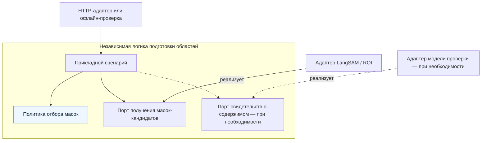

# Фильтр масок: архитектурный анализ и вводные для HLD

2026-10-18. **PRE-HLD / предложения для обсуждения**, STANDARD.
Основание — поручение владельца проанализировать решение с точки зрения
гексагональной архитектуры и подготовить вводные для HLD.
Это анализ границ, а не утверждение архитектуры, API, требований или нового ML-допуска.
[Исследование](mask-filtering-research.md) · [Бэклог](backlog.md#отложено-фильтрация-составных-и-посторонних-масок)
· [Существующий HLD поиска](../../docs/architecture/nail-search-hld.md).

2026-10-19 выделены [кандидаты правил отбора](mask-filter-rule-candidates.md):
предметные решения отделены от эвристик и технических отказов. Это обсуждаемый
черновик; критерии пригодности, пороги и итоговые статусы ещё не утверждены.

## Архитектурное заключение

Размещать исполнение фильтра внутри текущего процесса локализации допустимо.
Но владение правилами нельзя отдавать HTTP-handler, SDK LangSAM или модулю
сборки зависимостей. Предлагается внутренняя логика отбора областей с plain-data
моделью, прикладным сценарием и внешними адаптерами для получения масок.
Смысл отбора — сохранить полезные отдельные ногти, а не привести количество
областей к ограничению транспорта.

Уточнение к предварительному ответу «ядро не меняется»: алгоритм сопоставления
и формулы ранжирования можно сохранить; внутри возможности локализации появятся
новые правила и прикладная оркестрация. Сохранение API поиска возможно при
совместимой семантике исходов. Это условие, не уже доказанный контракт.

Модуль, приложение и процесс не тождественны. Поиск может видеть локализацию
как внешний адаптер своего порта; одновременно внутри локализации могут быть
свои правила и порты. Для этого не требуется новый микросервис, отдельная БД
или общее ML-окружение.

Принципы: [Cockburn, Ports & Adapters](https://alistair.cockburn.us/hexagonal-architecture/)
отделяет приложение от способов вызова и внешних устройств;
[Clean Architecture](https://blog.cleancoder.com/uncle-bob/2012/08/13/the-clean-architecture.html)
направляет зависимости к внутренним правилам. Применительно к фильтру это
означает: политику можно проверить без HTTP, БД, файлов и настоящей модели.

## AS-IS: что подтверждено исходным кодом

| Участок | Наблюдение | Значение для HLD |
|---|---|---|
| [NailLocalizationPort](../../src/product_search/search/nail_ports.py) | Порт принадлежит поисковому приложению; принимает RGB/plain profile, возвращает NailLocalization | Поиск уже имеет границу с реализацией локализации |
| [HttpNailLocalizationAdapter](../../src/product_search/infrastructure/nail_ml_adapters.py) | Преобразует вызов порта в HTTP и нормализует транспортные ошибки | HTTP — внешний механизм, не место правил отбора |
| [CandidateIBinding](../../services/candidate_i/binding.py) | Создаёт LangSAM/ROI implementation и преобразует detections в LocalizedRegion | Есть место для подключения сценария, но binding уже смешивает сборку и mapping; не следует добавлять сюда политику отбора |
| [LangSAMAdapter](../../experiments/nail_localization/langsam_adapter.py) | Нормализует SDK output, берёт confidence из scores; mask_scores в Detection не сохраняется | Для дополнительных свидетельств качества потребуется уточнить внутреннюю нормализацию, не обязательно HTTP |
| [HTTP app](../../services/candidate_i/app.py), [encode_result](../../src/product_search/infrastructure/nail_wire.py) | Handler вызывает binding, затем сериализацию; encode_result проверяет max_region_count | Отбор после HTTP-ответа не решит отказ на11 областях: ответ уже отклонён |
| [NailImageProcessor](../../src/product_search/search/nail_image_processor.py) | Общая обработка query/catalog через порт; повторно проверяет max_regions и формирует кропы | Фильтрацию нельзя отдельно дублировать в query и catalog ветках |
| [NailLocalization](../../src/product_search/search/nail_contracts.py) | Допустимы OK с непустыми областями либо NO_NAILS без областей; ordinals последовательны, порядок соответствует confidence/box/label | Три исхода на уровне отдельной маски не выражаются существующим photo-level DTO |
| [Bootstrap](../../services/candidate_i/bootstrap.py) | Проверяет code/model/config identity и собирает runtime | Подключение новых реализаций и обновление pins относятся к внешней сборке |

Это статическая проверка кода. Развёртывание, runtime readiness и фактические
контракты внешних клиентов в этой задаче не проверялись. Датированные AS-IS
сведения существующих HLD не заменяют эту проверку текущего checkout.

## Рекомендуемая граница для обсуждения

Предлагается оставить один процесс локализации, но выделить в нём независимую
возможность «Подготовить области отдельных ногтей». Имена ниже иллюстрируют
ответственности; это не согласованный перечень Python-классов или endpoint.

| Ответственность | Место | Что в неё не входит |
|---|---|---|
| Правила полезности, дублей и допустимой неопределённости | Внутренняя политика отбора | HTTP, env, чтение файлов, загрузка моделей, формат SDK |
| Получить кандидатов, собрать необходимые свидетельства, применить политику, сформировать результат | Прикладной сценарий подготовки областей | Конкретный клиент LangSAM/HTTP, создание моделей и DB connections |
| Контракт получения исходных масок-кандидатов — условное имя MaskProposalPort | Выходной порт, которым владеет сценарий локализации | SDK types, обязательный SAM/GDINO, транспортный предел10 как правило отбора |
| Вызов LangSAM/ROI и перевод результата в plain candidates | Выходной адаптер порта кандидатов | Самостоятельное решение, что группа типсов подходит для поиска |
| Дополнительные свидетельства о содержимом, если они нужны | Возможный выходной порт оценки регионов и модельный адаптер | Автоматический выбор порогов и бизнес-решения внутри SDK adapter |
| Приём HTTP-запроса и выдача ответа | Входной адаптер сервиса локализации | Правила удаления масок и знание конкретных моделей |
| Конкретные реализации, ресурсы, версии и связи | Composition root / bootstrap | Решение о полезности конкретного ногтя |

Геометрические операции могут оставаться чистыми функциями внутреннего модуля,
если не требуют внешних библиотек. Если выбирается OpenCV или иной механизм,
его типы не должны попадать во внутреннюю модель. Отдельный GeometryPort
нужен только при обоснованной границе замены/зависимостей; порт для каждой
арифметической функции не предлагается.

Входной порт также не обязан быть отдельным Protocol: это может быть метод
прикладного сценария. Реализация всех ролей не требует отдельного класса на
каждую строку таблицы. Отдельный репозиторий/audit service без потребности
в сохранении решений не предлагается.

## Схема зависимостей предлагаемого модуля

Стрелки показывают **зависимости кода**, а не последовательность HTTP-вызовов.
Пунктир отмечает условный участок, который нужен только при выборе модельной
проверки. Все внутренние интерфейсы принадлежат возможности локализации.

Модель данных и контракты располагаются внутри той же границы, но не показаны
отдельными узлами. Схема отражает предложение; её визуальный рендер не проверен.

## Порядок выполнения и защита ресурсов

Предлагаемый runtime-порядок, отдельно от схемы зависимостей:

1. Входной адаптер проверяет формат, identity и допуск запроса.
2. Сценарий через порт получает исходные кандидаты; адаптер переводит SDK output
   в общую систему координат и типы данных.
3. Анализируются отношения масок; при обоснованной необходимости запрашиваются
   дополнительные свидетельства. Политика формирует решения и photo-level исход.
4. На границе результата назначается стабильный порядок и отображение исходных
   candidates в выходные ordinals. Исключённые ordinals не переиспользуются как
   доказательство прежней идентичности; lineage сохраняется в диагностике.
5. Проверяются допустимый размер результата/лимит областей, затем формируется HTTP-ответ.
6. Существующий поисковый адаптер получает выбранные области; общий processor
   формирует кропы, далее embeddings и matching работают по своим контрактам.

Предел количества сырых кандидатов, размер/разрешение масок и память нужны
**до попарного анализа**, независимо от выходного лимита10. Нельзя считать
«фильтр стоит до лимита» разрешением на неограниченный вход. Превышение
ресурсного допуска не должно приводить к скрытому усечению масок.

Readiness, deadline, admission, device lock, lifecycle и cleanup остаются
ответственностью внешней оркестрации. Добавление новой модели требует включить
её в этот допуск и бюджет; гарантия чистых правил сама по себе не обеспечивает
безопасное исполнение модели.

## Данные на границе

Для HLD предлагается зафиксировать смысл данных, не выбирать сейчас поля API:

- Кандидат: стабильная ссылка в пределах обработки изображения, бинарная маска,
  размеры/координаты, доступные оценки с указанием происхождения. Отсутствующая
  оценка SAM не подменяется detector confidence или числом0.
- Политика: версия и согласованные параметры отбора, переданные явно.
- Решение: ссылка исходного кандидата, оставить/исключить/не уверен, причина
  и необходимые свидетельства. Счёт модели отделён от решения политики.
- Итог фото: выбранные области, исход обработки и ссылка на версию представления;
  диагностические решения могут храниться отдельно от публичного payload.

Через внутренние контракты не проходят FastAPI Request/Response, Pillow Image,
Torch Tensor, OpenCV/NumPy objects, ORM rows или пути к весам. Представление
геометрии следует выбрать с учётом стоимости копирования; plain-data контракт
не означает необходимость копировать каждый полноразмерный массив на каждом шаге.

Отбор целых масок, исправление геометрии и изменение гранулярности — разные
возможности. Создание новых областей дроблением или до-сегментацией расширяет
задачу и не следует автоматически из интерфейса фильтра.

## Что меняется и что может сохраниться

| Область | Предварительная оценка |
|---|---|
| Локальные правила и сценарий локализации | Новая внутренняя логика; это изменение ядра возможности локализации |
| LangSAM normalization, binding и bootstrap | Потребуется mapping/подключение; адаптер не владеет политикой |
| NailLocalizationPort и текущий HTTP DTO | Могут сохраниться, только если выбранные photo-level исходы ими выражаются без потери смысла |
| UI поиска и внешние search endpoints | Нет подтверждённой необходимости менять для простого отбора; потребность в публичном uncertain может изменить оценку |
| matching/assignment и формулы | Для отбора существующих масок менять алгоритм не требуется; изменение числа областей всё равно влияет на scores |
| Профиль/identity и подготовленный каталог | Отбор влияет на представление; необходима версия политики в цепочке identity и явное правило совместимости |
| SQL-схема и аудит | Изменение не доказано необходимым; зависит от требований хранения решений и lineage |
| Новый процесс/микросервис | Сам по себе не нужен; возможная изоляция модели — отдельное операционное решение |
| Поддержка20 корректных областей | Отдельная работа с транспортными caps, processor limits и бюджетом solver; не результат фильтрации |

Новый профиль означает необходимость определить затронутые представления и
правила query/catalog совместимости. Он не разрешает автоматически пересчитать
весь каталог. Формат identity, этап миграции, объём пересборки и активация —
предмет отдельного решения, с сохранением старого оценочного каталога.

## Ключевые альтернативы

| Вариант | Архитектурная оценка |
|---|---|
| Политика прямо в HTTP-handler/binding | Малый начальный diff, но предметные решения смешиваются с transport/SDK; повторное использование и тестирование затрудняются |
| Независимая политика/сценарий внутри текущего процесса локализации | Рекомендуемый кандидат для HLD: сохраняет ранний отбор и отделяет зависимости без нового сетевого перехода |
| Отбор только в поисковом processor после HTTP | Совместно используется query/catalog, но текущий cap10 может отклонить результат раньше; потребует иного контракта возврата raw candidates |
| Новый сервис фильтра | Не обеспечивает hexagonal границы сам по себе; добавляет передачу изображений/масок, версии, сетевые отказы и эксплуатацию. Пока необходимость не установлена |

Правильность правил сама по себе не зависит от того, исполняются они локально
или удалённо. Выбор размещения должен учитывать размер масок, ресурсы модели,
задержку и независимость обновлений, а не форму шестиугольника на схеме.

## Вопросы для HLD: вопрос → влияние → предварительный ответ

Все ответы ниже — предложения модели для обсуждения, не решения владельца.

| Вопрос | Влияние | Предварительный ответ модели |
|---|---|---|
| Что является единицей результата? | Критерии качества и понятие дубля | Отдельный физический ноготь; группы и фон не заменяют его |
| Фильтр только отбирает или исправляет маски? | Scope, lineage и необходимость повторной сегментации | На первом этапе только отбирает/помечает существующие; исправление отдельно |
| Где владеем правилами? | Направление зависимостей и общая обработка query/catalog | В возможности локализации, независимо от SDK/HTTP; исполняем до выходного cap |
| Что делать с uncertain? | Полнота результатов, readiness и необходимость нового DTO | В исследовании сохранять и показывать отдельно; production-поведение определить до интеграции |
| Что значит «все маски отвергнуты»? | Совместимость NO_NAILS, ошибка обработки и пустой результат | Не приравнивать автоматически к отсутствию ногтей; смысл исхода согласовать отдельно |
| Что делать при отказе дополнительной модели? | Предсказуемость деградации | Явный исход/ошибка; не считать неуспех оценки разрешением молча выбросить маски или выдать успешный обход |
| Где хранить объяснения? | Приватность, воспроизводимость и возможные изменения storage | В ограниченной диагностике; SQL/API расширять только при подтверждённой потребности |
| Что определяет совместимость? | Использование старых embeddings и query/catalog | Версия отбора и его конфигурация входят в identity представления; детали и миграцию согласовать |
| Нужен ли семантический verifier? | Новый ML-порт/адаптер, допуски и стоимость | Решать по ошибкам опыта; старый Candidate J не объявлять готовой реализацией |
| Какие границы производительности? | Допуски сырых масок, площадь, время/RAM и solver | Сохранить действующие guards; конкретные значения определить по измерениям, не выводить из выходного max10 |

## Проверки, которые следует заложить в HLD

- Правила на масках/признаках тестируются без сети, БД, файлов, framework и модели.
- Прикладной сценарий проверяется fake-портом кандидатов и, если выбран, fake-портом
  свидетельств: обычные, пустые, спорные, ошибочные и превышающие допуск случаи.
- Адаптеры отдельно проверяют координаты/размеры, отсутствие сигналов качества,
  SDK mapping, сериализацию и допустимые статусы.
- Путь с11 кандидатами проверяет порядок: анализ до выходного лимита; путь с20
  настоящими ногтями доказывает отсутствие подгонки под10, но не готовность matching20.
- Query и catalog используют одну версию правил; несовместимость identity не скрывается.
- Архитектурная проверка запрещает внутренним модулям импортировать SDK, transport,
  storage и читать env. Чистый тест сам по себе не заменяет эту проверку зависимостей.
- Качество оценивается по сохранению физических ногтей и оставшимся ошибочным
  областям; technical PASS не подменяет размеченную оценку качества.

Проверки здесь запланированы, не выполнены. Реализации фильтра пока нет.

## Готовность вводных

Подготовлены границы, AS-IS локаторы, роли, варианты, предлагаемое направление
зависимостей, контракты по смыслу, влияние на систему и вопросы для выбора.
Чтобы превратить это в HLD, нужны решения по scope и исходам, включая uncertain,
пустой результат, модельные отказы, совместимость и критерии качества.
Только после этого можно фиксировать нормативную архитектуру и детальные контракты.

Существующий HLD/API/OpenAPI не изменены, runtime/ML не запускались.
Материал сам по себе не разрешает реализацию или активацию.
