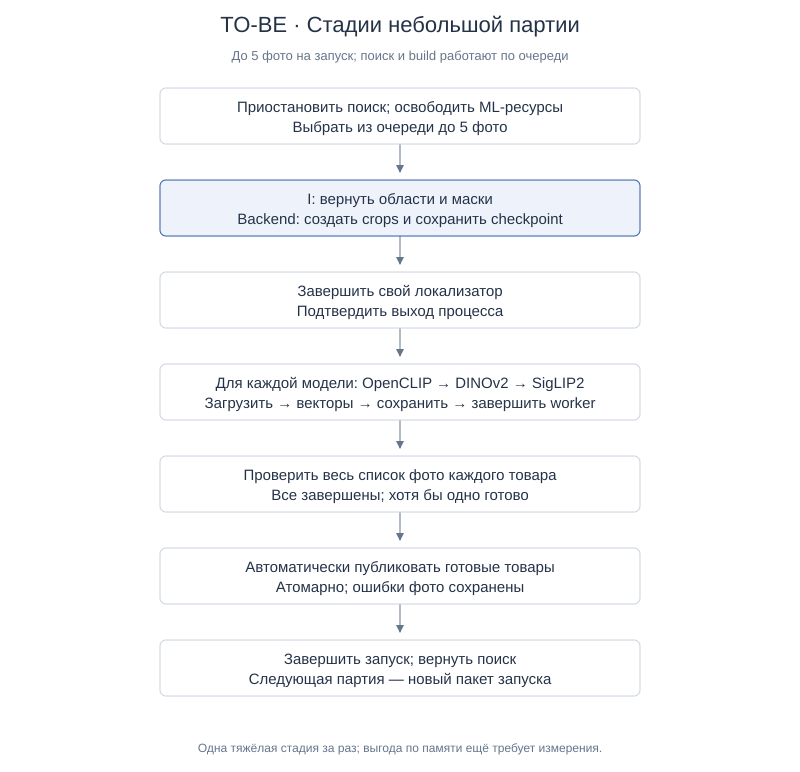
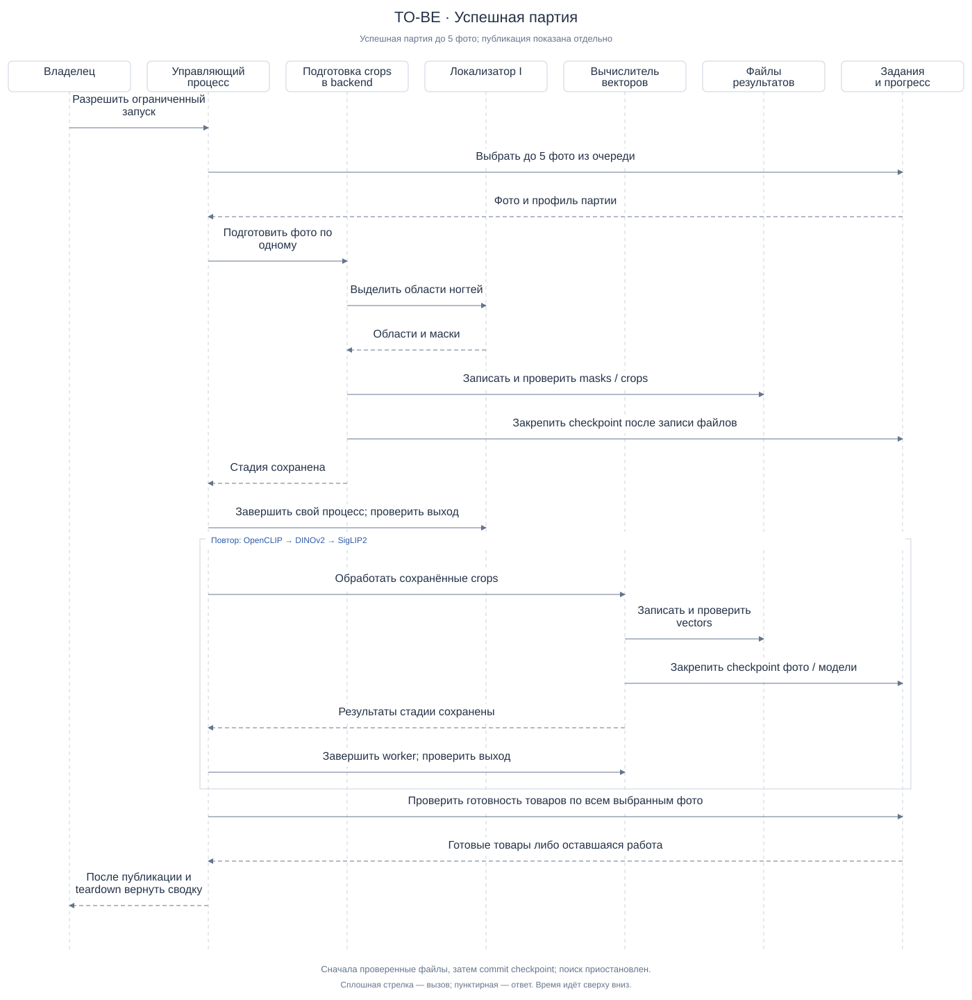
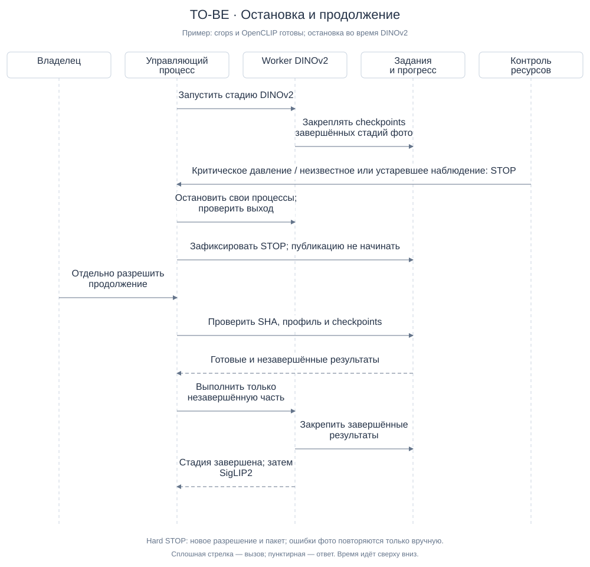
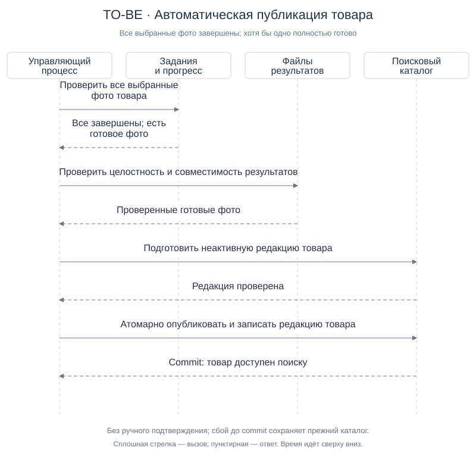

# TO-BE — подготовка корпуса небольшими партиями

| Паспорт | Значение |
|---|---|
| Дата / версия | 2026-10-12 / v2 |
| Назначение | Пополнять поиск небольшими партиями с сохранением прогресса |
| Статус | `APPROVED_BY_OWNER` — владелец утвердил TO-BE v2 сообщением «Да утверждаю» 2026-10-12 после review и исправления Minor |
| Граница | Обработка выбранного существующего корпуса; автоматическая публикация готовых товаров в будущем процессе |
| Входы | [AS-IS](as-is.md), [исследование](research-summary.md), [гипотезы](hypotheses.md) |

## 1. Контекст и цель

Поиску нужны заранее подготовленные фото товаров: выделенные ногти и их векторы.
Сборка выбранного набора из 100 фото остановилась по ресурсному ограничению.
Новый процесс должен сохранять завершённые части работы, ограничивать одновременную
ML-нагрузку и автоматически включать готовые товары в поиск.

Экономия памяти и длительная стабильность ещё не доказаны. Повторная загрузка
моделей и чтение диска могут увеличить время обработки. Небольшая партия не
уменьшает размер самой модели и не гарантирует, что одна стадия поместится в память.

Scope — выбранный существующий корпус. Очередь содержит задания обработки,
а не новый источник импорта. Изменение состава моделей не входит в этот проект:
для каждого готового фото нужны OpenCLIP, DINOv2 и SigLIP2.

### План-контракт этого уточнения

Зафиксировать ответы владельца, определить очередь/checkpoint и границы публикации,
согласовать текст и диаграммы, проверить ссылки и воспроизводимость SVG, провести
одно независимое read-only review. Продуктовый код, ML, БД и публикация не запускаются.
После исправлений владелец утвердил готовый документ; следующая работа — отдельный технический план.

## 2. Основные понятия

Базовые понятия совпадают с [AS-IS](as-is.md#2-основные-понятия).

| Термин | Простое объяснение |
|---|---|
| Очередь | Сохранённые задания, из которых выбирается незавершённая работа |
| Партия | До 5 фото на один запуск; фото одного товара могут оказаться в разных партиях |
| Стадия | Подготовка crops либо вычисление векторов одной моделью |
| Worker | Собственный процесс стадии; его завершение проверяется |
| Checkpoint | Запись о завершённой стадии фото, её профиле и проверенных файлах |
| Готовое фото | Проверенные crops и полный совместимый набор векторов трёх моделей |
| Завершённое фото | Готовое фото, техническая ошибка либо отсутствие найденных ногтей |
| Готовый товар | Все выбранные фото завершены, хотя бы одно фото готово |
| Опубликованный товар | Готовые фото товара включены в рабочие поисковые данные |

«Завершено» и «успешно» различаются. Фото с ошибкой завершает текущую попытку,
но не становится готовым. Наличие файла само по себе не является checkpoint.

## 3. Участники и ответственность

Роли на схемах — логические, а не названия новых сервисов.

| Участник | Ответственность |
|---|---|
| Владелец | Утверждает границы запуска; разрешает продолжение и ручной повтор ошибок |
| Управляющий процесс | Выбирает партию, запускает стадии, оценивает готовность товара и вызывает публикацию |
| Локализатор I | Возвращает области и маски; готовые crops не создаёт |
| Подготовка crops в backend | Создаёт crops из исходных пикселей по маскам I |
| Вычислитель векторов | Обрабатывает сохранённые crops одной моделью за стадию |
| Файлы результатов | Хранят masks/crops/vectors вне Git, с проверкой целостности |
| Задания и прогресс | Хранят выбранные фото товара, исходы, checkpoints и результат публикации |
| Поисковый каталог | Предоставляет поиску согласованный опубликованный набор |
| Контроль ресурсов | Проверяет бюджет, предупреждает либо выдаёт hard STOP |

Один управляющий процесс работает на текущем Mac. Отдельный брокер очередей
для первой версии не требуется: ожидающая работа выбирается из постоянных записей
существующей БД. Файлы и состояние показаны отдельно, чтобы было видно, где хранится
прогресс. Физическая схема таблиц относится к последующему техническому плану.

## 4. Входы, очередь и checkpoints

### Ограничение запуска

Один запуск обрабатывает не более 5 выбранных фото. Действующие лимиты source,
pixels, regions, памяти, admissions и времени сохраняются; достигается любой лимит —
новая работа не начинается. Очередная партия требует нового допустимого пакета запуска.
Число 5 — принятое начальное ограничение, а не измеренная безопасная ёмкость.

Для товара заранее фиксируется список выбранных фото. Остальные задания этого
товара сохраняются между запусками. Изменение списка или смыслового профиля создаёт
новую редакцию обработки; старые и новые результаты молча не смешиваются.

### Минимальная информация в состоянии

| Уровень | Что хранить |
|---|---|
| Товар | Редакция выбранного списка фото, профиль, готовность и опубликованная редакция |
| Фото | Связь с товаром, исходный SHA, исход обработки и причина ошибки |
| Стадия фото | Ожидает / выполняется / завершена / ошибка; попытка, профиль и checkpoint |
| Checkpoint | Ссылки и контрольные суммы artifacts, полнота, версия подготовки и модель/её версия |
| Запуск | Выбранная партия, лимиты/срок, причина завершения и ресурсные наблюдения |

Это смысл записей; точные DB states, поля и индексы задаются в техническом плане.

### Закрепление результата — проектный механизм

1. Worker пишет результат во временное место собственной попытки.
2. Backend проверяет состав, целостность и совместимость файлов; переводит их
   в окончательное неизменяемое расположение атомарным переименованием на том же файловом томе.
3. Транзакция БД закрепляет checkpoint и завершение стадии. Только после commit
   управляющий процесс считает стадию готовой.

БД и файловая система не имеют общей транзакции. Сбой до commit может оставить
файл без checkpoint: он не используется как готовый результат. На восстановлении
такие файлы проверяются и изолируются; автоматическое удаление исходников не предлагается.
Если файл закреплённого checkpoint отсутствует или повреждён, стадия требует
перерасчёта после отдельного разрешения, а не молчаливого переиспользования.

Повторный commit той же стадии/попытки не создаёт дубликат. После сбоя запись
«выполняется» не означает завершение: сначала проверяются отсутствие прежнего
worker и пригодность checkpoints. Один controller исключает конкурирующие запуски.

## 5. Основной сценарий

[PlantUML-исходник](diagrams/to-be-overview.puml).

1. Поиск и пополнение работают по очереди. До ML-обработки контроллер прекращает
   приём новых поисковых запросов, дожидается текущего запроса в пределах срока
   запуска и подтверждает освобождение собственных поисковых ML-процессов/моделей.
   Если это не подтверждено, build не стартует. В интерфейсе поиск временно недоступен.
2. Контроллер читает очередь и выбирает до 5 фото, учитывая действующие лимиты.
3. Backend обрабатывает фото по одному: вызывает I, получает области/маски,
   создаёт crops и закрепляет checkpoint. Без ногтей сохраняется отдельный исход.
4. Контроллер завершает свой I worker и проверяет выход процесса.
5. Worker OpenCLIP читает crops последовательно и закрепляет векторы каждого фото.
   После его завершения аналогично запускаются DINOv2 и SigLIP2. В RAM не загружается вся партия.
6. После teardown проверяются полнота и совместимость фото. Затем проверяется
   весь выбранный список каждого затронутого товара, включая предыдущие партии.
7. Готовые товары автоматически публикуются по правилам раздела 7. Неготовые
   остаются в очереди; после hard STOP публикация в этом запуске не начинается.
8. Контроллер сохраняет сводку, подтверждает выход своих workers и освобождение
   ресурсов; затем возвращает возможность поиска. При проблеме teardown поиск
   остаётся недоступным, причина видна владельцу. Новый build не запускается автоматически.

[PlantUML-исходник](diagrams/to-be-sequence.puml).

Сам I может содержать несколько моделей. Одна тяжёлая стадия за раз не означает
«одна модель во всей системе». Чужие процессы не завершаются.

## 6. Ошибки, ожидание и продолжение

| Ситуация | Правило |
|---|---|
| Ногти не найдены | Завершить фото отдельным исходом без encoder calls |
| Техническая ошибка фото | Записать причину, завершить попытку; продолжить независимые фото |
| Повтор ошибки | Только вручную, в новом допустимом запуске; готовые совместимые стадии переиспользовать |
| Ошибка БД, состояния или общего хранилища | Завершить запуск: прогресс нельзя достоверно закреплять |
| Warning нагрузки | Не начинать новую тяжёлую операцию; текущая заканчивается под действующим guard |
| Истёк тайм-аут ожидания | Завершить запуск, сохранить прогресс; продолжение вручную |
| Critical / unknown / stale наблюдение | Действующий hard STOP без ожидания и автоматического повторного запуска |
| Незавершённый artifact | Не признавать checkpoint; проверить и изолировать частичный результат |

Ожидание после warning длится **не более 5 минут** и не дольше оставшегося времени
разрешённого запуска. Отсчёт начинается с входа в паузу, не сбрасывается при
колебаниях нагрузки. Для автоматического продолжения нужны **30 секунд подряд**
достоверных допустимых измерений. Warning обнуляет период устойчивости, но не
продлевает тайм-аут. Critical, unknown или stale сразу переводят паузу в hard STOP.
При следующем отдельном эпизоде warning начинается новый тайм-аут; общий срок
запуска ограничивает суммарное ожидание. Пауза не возобновляет исчерпанный
admissions budget, claim или истёкший пакет запуска.

Числа 5 минут и 30 секунд согласованы как начальные настройки. Пороги warning,
critical, свежесть измерений и наблюдение берутся из действующего ресурсного
профиля и не ослабляются этим документом. Завершение текущей операции при warning
также ограничено оставшимся сроком запуска; hard STOP имеет приоритет.

[PlantUML-исходник](diagrams/to-be-resume.puml).

Продолжение после STOP/тайм-аута требует нового допустимого пакета и явного
разрешения. Проверяются входы, профиль, файлы и отсутствие прежних workers.
Повторяется незавершённая работа. Фото с сохранённой ошибкой повторяется только
по ручному выбору; ошибка не превращается при resume в автоматическое задание.

## 7. Автоматическая публикация товара

### Условие готовности

Товар готов, когда **все его выбранные фото завершены**, а **хотя бы одно готово**.
Фото с технической ошибкой или без ногтей завершает текущую попытку, но не
включается в поиск. Дополнительное ручное подтверждение исключения не требуется.
Если готовых фото нет, товар не публикуется, причина видна в сводке.

Партия до 5 фото не является единицей публикации. Например, у товара 7 фото:
после первой партии он ещё не готов; после завершения остальных двух можно
автоматически включить все его готовые фото. Ошибка другого товара не блокирует
публикацию готового. Изменение ранее завершённого исхода ручным retry создаёт
новую редакцию; опубликованные данные сохраняются до готовности её замены.

### Механизм публикации — проектное предложение

Публикация выполняется отдельной операцией контроллера автоматически, без
ручного подтверждения каждого товара, в пределах будущего разрешённого запуска.
Для каждого товара готовится полный совместимый набор поисковых данных в
неактивной редакции. После проверки транзакция БД атомарно делает эту редакцию
видимой поиску и фиксирует опубликованную редакцию товара.

Повторная публикация той же редакции не создаёт дубликаты. Ошибка до commit
оставляет прежний поисковый набор активным; частичный новый набор невидим.
Ошибка публикации записывается отдельно от ошибки ML. Повтор публикации — вручную
в новом запуске, без повторения пригодных ML-стадий. Иные товары сохраняются.

Это контракт будущей реализации, а не заявление о наличии механизма. Точный
способ интеграции с действующей версией корпуса и SQL-фильтрацией нужно выбрать
в техническом плане; он должен обеспечить атомарную видимость всех готовых фото
товара и прежнюю доступность остальных товаров, без пересчёта их векторов.
При изменении смыслового профиля автоматическое смешивание редакций запрещено.

[PlantUML-исходник](diagrams/to-be-publication.puml).
Схема показывает успешный путь после проверки готовности; ошибки описаны выше.

## 8. Решения владельца и границы утверждения

Основание: ответы владельца в этом чате 2026-10-12. Тип — `OWNER_DECISION`;
статус evidence — `VERIFIED` для содержания ответов, не для работоспособности.

| Вопрос | Решение и основание |
|---|---|
| Покрытие | «1 хотя бы одно» — хотя бы одно полностью готовое фото |
| Публикация | «2 Автоматически публиковать каждый готовый товар» |
| Несколько фото | «после обработки всех выбранных фото» |
| Совместная нагрузка | «3 Поиск и пополнение работают по очереди» |
| Ожидание warning | «Хорошо» на предложение 5 минут / 30 секунд устойчивости / предел срока запуска |
| Ошибки и первая партия | «да» на ручной retry и до 5 фото на один запуск |

Прикладные вопросы закрыты этими ответами. БД без брокера, протокол checkpoint,
механизм публикации, переходы при сбое и управление режимом поиска — инженерные
предложения в этой редакции; они проверены при review и утверждены владельцем
в составе целостного документа сообщением «Да утверждаю» 2026-10-12.
Физические таблицы, SQL, точные параметры launch-профиля и численные критерии
испытания задаются в техническом плане и пакете проверки владельцем до реализации/запуска.
Это детализация выбранного процесса, а не разрешение начинать её сейчас.

Утверждение этого текста не является операционным разрешением на ML/build/DB/publish,
перенос на VM, новый импорт, отключение моделей, merge/push или публикацию портфолио.
Действующие claims и контрольные точки сохраняются. Исходное
[предложение](../candidate-i-http/incremental-corpus-proposal.md) — исторический вход;
его открытые варианты не заменяют решения этой редакции.

## 9. Проверка проекта

До запуска будущей реализации проверить:

- очередь и checkpoints переживают перезапуск; второй controller не получает владение;
- сбой до/после записи файлов и commit не объявляет частичный результат готовым;
- совместимые стадии не повторяются, повреждённые и чужие профили отклоняются;
- ошибка фото не блокирует независимые задания; ручной retry не запускается сам;
- товар из 7 фото не публикуется после первых 5; после остальных публикуется только с готовым фото;
- все фото ERROR/NO_NAILS означают отсутствие публикации;
- публикация одной редакции атомарна, повтор не дублирует данные, сбой сохраняет прежний каталог;
- warning: восстановление до 5 минут, колебания без продления, 30 секунд устойчивости,
  тайм-аут, предел запуска и hard STOP во время ожидания;
- поиск и build не пересекаются по ML-резидентности, teardown подтверждён;
- повторные партии измеряют память/load/encode/teardown и совместимость векторов.

Эти сценарии — план проверки, не результаты тестов. Численные критерии памяти,
качества и времени и конкретные входы закрепляются отдельно до испытания.

## 10. Источники и история

- [AS-IS](as-is.md) — подтверждённое устройство текущей реализации.
- [Исследование](research-summary.md) — evidence и ограничения.
- [Гипотезы](hypotheses.md) — ожидаемые эффекты, ещё не подтверждённые.
- [Принятый алгоритм](../candidate-i-http/g2-core-decisions.md) — три модели сохранены.

v1 — исходный проект с открытыми вопросами. v2 — ответы владельца и конкретные
инженерные предложения; после review и исправления Minor целостный результат
утверждён владельцем 2026-10-12 сообщением «Да утверждаю».

### Проверка документа v2

Один независимый read-only reviewer: 0 Critical / 0 Major / 1 Minor.
Уточнена граница полномочий: review проверяет, владелец утверждает; Minor исправлен,
повторное review не требуется по правилам проекта. Проверены относительные ссылки,
таблицы, конфликтные маркеры, SVG XML/accessibility, соответствие JSON/SVG/PUML,
воспроизводимость генерации и отображение изменённых SVG в браузере.
Компиляция PlantUML не выполнялась: Java/PlantUML отсутствуют.
Runtime, качество поиска, экономия RAM, миграции и публикация не проверялись.
